# Agentic Software Engineering System

A working prototype that turns a **software requirement** into a **reviewable engineering outcome**: a plan, code, an API contract, tests, documentation and a
structured engineering summary. A lead agent plans the work, specialised agents write the code and the tests, a validator that actually *runs* things judges the result,
and humans approve at the points that matter.

> Python 3.9+ (developed on 3.10), **standard library only**: nothing to install. It needs **one model** from any provider (Azure, OpenAI-compatible, Anthropic, or a CLI) for
> the agents. The test suite needs no model.

---

## 1. The ask (in plain English)

The assignment: *design and build an agentic system that carries a requirement through the software lifecycle*. It is **not a chatbot**. You hand over a requirement and get back
engineering work products. It must show:

| The assignment asks for | Where this project shows it |
|---|---|
| Understand the requirement, find ambiguity, restate it as an engineering problem | requirement analyst; the clarification pause ([use case 3](docs/usecases/03_AMBIGUOUS.md)) |
| Break work into tasks with dependencies and an order | the lead agent's plan, checked by the harness (`output/*/plan.json`) |
| Reason about existing code (impacted modules, APIs, data flows) | codebase analyst ([use case 2](docs/usecases/02_BROWNFIELD.md)) |
| Orchestrate: parallelism, coordination between steps, error handling and recovery | the loop: retries, repair rounds, degrade, resume, fault injection |
| Produce code, API contracts, tests, docs | the generated URL shortener ([use case 1](docs/usecases/01_GREENFIELD.md)) |
| Validate and control risk: risks, trade-offs, test strategy, guardrails | the validator, risk register, sandbox, protected tests |
| **Controlled autonomy**: agents act alone, humans oversee | three human gates; every decision audited |
| A final structured engineering summary | `ENGINEERING_SUMMARY.md` in every run |

The mandatory example: *"Build a scalable URL shortener service with APIs, persistence, and analytics."*

## 2. The use cases we cater to

| # | Use case | Example requirement | Command | Read |
|---|---|---|---|---|
| 1 | **Greenfield**: build something new | "Build a scalable URL shortener service with APIs, persistence, and analytics." | `python run.py greenfield` | [01_GREENFIELD](docs/usecases/01_GREENFIELD.md) |
| 2a | **Brownfield: bug fix. Your first brownfield test** | "Fix the bug where link stats report unique_visitors equal to the total number of clicks" | `python run.py brownfield --verify` | [02_BROWNFIELD](docs/usecases/02_BROWNFIELD.md) |
| 2b | *Advanced:* brownfield **enhancement** (changes the API; **can fail**, a legitimate result) | "Add support for expiring short links ... return 410 Gone" | `python run.py enhancement` | same |
| 2c | *Advanced:* brownfield **refactor** | "Refactor the stats query code into small helpers, without changing behaviour" | `python run.py refactor --verify` | same |
| 2d | *Advanced:* brownfield **tests / docs** | "Improve test coverage for link deletion and alias validation" | `python run.py tests --verify` | same |
| 3 | **Ambiguous requirement** | "Make the link service faster and more secure." | `python run.py ambiguous` | [03_AMBIGUOUS](docs/usecases/03_AMBIGUOUS.md) |

### Inputs and outputs

Each scenario has an **input** in [`input/`](input/README.md) and an **output** in `output/` with the same name:

```
input/<scenario>/requirement.txt   -->   python run.py <command>   -->   output/<scenario>/
```

| Scenario | Input | Output |
|---|---|---|
| greenfield | `input/greenfield/requirement.txt` (one sentence) | `output/greenfield/` (the service, tests, docs, contract, summary) |
| brownfield (bug fix) | `input/brownfield/requirement.txt` (a bug report) **plus existing code**: a copy of the greenfield service with one bug planted | `output/brownfield/` (the fix as `release/changes.diff`, new tests, proof, summary) |
| enhancement, refactor, tests | `input/enhancement/`, `input/refactor/`, `input/tests_improvement/` + the existing service | `output/enhancement/`, `output/refactor/`, `output/tests_improvement/` |
| ambiguous | `input/ambiguous/requirement.txt` + `answers.json` (the human's answers) | `output/ambiguous/` (clarification questions, then `docs/PROPOSAL.md`) |

Each run also copies the input it used into `output/<scenario>/input/`, so an output always shows what produced it. Use your own requirement with
`--requirement-file my.txt`, or `python run.py custom "<text>" [--repo <path>]`.

**Brownfield, in one sentence:** the URL shortener already exists and a person asks for a change; the agents work out *where* in the existing code it belongs, change it
minimally, and prove it. **The agents do not discover bugs**: for the bug-fix demo the system plants one bug in a copy of the shortener, and the request reports it in plain English.
Start with 2a (one command, one verify); treat 2b to 2d as advanced.

The system detects the **kind** of change from the wording. The kind decides which agents may be used and what proof the validator demands (for example, a refactor must leave the API
identical, a tests-only change may not touch production code, a bug fix's new tests must fail on the buggy code).

## 3. How it works in one picture

```mermaid
flowchart LR
  REQ["Requirement<br/>(+ existing repo)"] --> DISC["Discover<br/>analyse text and code"]
  DISC --> LEAD(["Lead agent (model)<br/>proposes the task plan"])
  LEAD --> CHK["Harness checks the plan<br/>against the tool catalog"]
  CHK -- "rejected + reason" --> LEAD
  CHK --> G1{{"Human gate:<br/>approve the plan"}}
  G1 --> LOOP["Loop: run ready tasks in parallel,<br/>lead picks the order"]
  LOOP --> W["Worker agents (models) write code and tests<br/>Steps (plain Python) design, analyse, document"]
  W --> VAL["Validator<br/>executes the checks"]
  VAL -- "failure blames a role" --> LOOP
  VAL --> G2{{"Human gate:<br/>approve any amended test, then the release"}}
  G2 --> OUT["release/ + ENGINEERING_SUMMARY.md"]
```



Plain-English version: **discover** what is being asked (and what already exists), let a **lead agent plan** the tasks, have the **harness check the plan** against fixed rules, a
**human approves it**, the agents **do the work** in parallel, a **validator runs** syntax, behaviour probes, the tests, API diffs and test-integrity checks, failures are **sent
back to whoever is responsible**, and only after a **human approves the result** are files released.

## 4. How the agents are designed

**The principle:** *the model chooses structure and order; the harness owns permissions, verification and release.* Models are treated as untrusted producers.

There are exactly **four model-backed agents**. Each is a Markdown file in [`agentic/agents/`](agentic/agents/) (role, responsibilities, guardrails, failure handling, system prompt) so its
behaviour can be reviewed without reading code.

| Agent | What it does | What it cannot do |
|---|---|---|
| `project_lead` | proposes the task plan; each turn picks which ready tasks start | write files, widen a permission, approve anything |
| `requirement_analyst` | normalises the requirement, finds vague terms (rules; the model may only *add* questions) | remove or change a rule-based result |
| `code_author` | writes the service (greenfield) or proposes minimal anchored edits (change) | edit tests; write outside its scope |
| `spec_tester` | writes tests from the **specification only**, never seeing the code | read the code; edit existing tests (except one narrow, human-approved case) |

Everything else is a **step**: deterministic Python with no model call (architecture decisions, OpenAPI contract and schema, risk register, test strategy, codebase analysis,
documentation, the validator, the summariser). They are reproducible and unit-tested, and are deliberately **not** called agents.

Five layers, each calling only the one below:

```
1. Interfaces   run.py (CLI)  ·  agentic/api.py (HTTP with remote approval)
2. Harness      harness.py (flow)  lead.py (plan + plan check)  loop.py (execution)  tools.py (the permission catalog)
                approvals.py (gates)  report.py (summary)  narrator.py (the plain-English run story)
3. Workers      agents (models, agentic/agents/*.md + authoring_agents.py)   steps (Python, agentic/steps/)
4. Guardrails   guardrails.py: path jail, write scopes, extension allow-list, secret scan, protected tests, isolated test runner
5. Models       providers.py: one contract, complete_json(system, prompt); azure | openai-compatible | anthropic | command
```

Agents never call each other. They coordinate through a shared record of facts (the *blackboard*: `contract`, `schema`, `code`, `tests`, ...) that tasks publish and consume. For example the
test author waits for the OpenAPI contract the code author publishes, but never sees its code, so the tests are an independent check. The full design, with diagrams, is in
**[docs/ARCHITECTURE.md](docs/ARCHITECTURE.md)**.

**Controlled autonomy, concretely:**
- *Autonomy:* after the plan is approved, about ten tasks run in parallel with retries and self-repair, with no human in the loop.
- *Control:* three human gates (the plan; any amended existing test; the release), a sandbox, write scopes that come from a catalog the model cannot edit, bounded loops, a secret scan, and an audit log of every decision.
- *Nothing grades itself:* the validator is code; tests come from a separate model call; the author cannot edit the tests that judge it; a bug fix's tests must fail on the old code.

## 5. Quick start

```powershell
copy .env.example .env                        # then fill in ONE model provider (see docs/MODEL_SETUP.md; works without Azure)
python scripts/model_smoke.py                 # prove the model connection first
python run.py greenfield                      # the mandatory use case (about 9 minutes)
python run.py brownfield --verify             # your first brownfield test: plant a bug, fix it, prove it (3 to 5 minutes)
python scripts/verify_outputs.py              # re-check every scenario from the files on disk, re-running each release's tests
python -m unittest discover -s tests -t .     # framework tests: 266, offline, about 5 minutes, no model needed
```

Then open `output/greenfield/RUN_STORY.md` (what happened) and `output/greenfield/DEMO_RESULT.md` (the proof: a real long URL shortened by the service the agents built, then redirected back). To use the service yourself:

```powershell
cd output/greenfield/release
python -m shortener.server --port 8080
```

Everything else (each scenario's command, what to open, how to know it worked, failure demos, a five-minute demo script) is in
**[docs/HOW_TO_RUN_AND_VERIFY.md](docs/HOW_TO_RUN_AND_VERIFY.md)**. No Azure Foundry? **[docs/MODEL_SETUP.md](docs/MODEL_SETUP.md)** covers OpenAI, Claude, GitHub Models, local models and a tool's CLI.

## 6. What a run produces, and how to investigate it

Take the mandatory use case. After `python run.py greenfield` finishes, the terminal prints where everything is:

```
>> status: completed
>> run story (plain English, what happened and why): output\greenfield\RUN_STORY.md
>> demo result (the service really used: long URL -> short URL -> redirect): output\greenfield\DEMO_RESULT.md
>> input used: output\greenfield\input
>> engineering summary: output\greenfield\ENGINEERING_SUMMARY.md
>> released artifacts:  output\greenfield\release
```

### The folder, at a glance

```
output/greenfield/
├── RUN_STORY.md             READ FIRST: the run in plain English, stage by stage
├── DEMO_RESULT.md           THE PROOF: a real long URL shortened by the service the agents built
├── ENGINEERING_SUMMARY.md   THE FORMAL REPORT: plan, rationale, artifacts, validation, risks, approvals, limits
├── release/                 THE PRODUCT: the validated service (only exists if a human approved the release)
│   ├── shortener/             the service code (written by the code_author agent)
│   ├── tests/                 the test suite (written by the spec_tester agent, from the spec only)
│   ├── openapi.json           the API contract (all code and tests are built against it)
│   ├── schema.sql             the database schema
│   ├── docs/                  ADR.md, ARCHITECTURE.md, RISKS.md, TESTING.md
│   └── README.md, Dockerfile, pyproject.toml, .gitignore
├── input/requirement.txt    a copy of exactly what this run was given
├── plan.json                the task plan the lead agent proposed and the harness accepted
├── events.jsonl             the complete audit log: every decision, one JSON line each
├── summary.json             status and gate decisions, for programs
├── state.json               the checkpoint that lets --resume continue a stopped run
└── workspace/               the sandbox the agents wrote into (internal; release/ is the validated copy of it)
```

### What each artifact is, who made it, and when to open it

| Artifact | What it is | Made by | Open it when you want to... |
|---|---|---|---|
| **`RUN_STORY.md`** | The whole run told in order, in plain English: what was asked, the lead agent's plan, which **AGENT (model)** or plain-Python **step** acted, what each validation check proves, the human gates, and the result. Written live while the run executes. | the harness (`narrator.py`) | understand what happened and why. **Start here.** |
| **`DEMO_RESULT.md`** | After the release, the service is really started, two real long URLs are shortened, the short URLs are followed and the analytics are read. For a bug fix it also shows the bug **before and after**. It is the only place a long URL and its short URL appear side by side. | the harness (`demo.py`) | **see it work**. The short URLs stop resolving once the demo ends. |
| **`release/`** | **The product**: everything the agents produced and the validator approved, ready to run. It exists only after the release gate. | agents and steps (below) | run it, read it, ship it. This is the real deliverable. |
| `release/shortener/` | The service: HTTP layer, business rules, storage, cache, analytics, rate limiting, validation, server. File names inside differ between runs, because the model chooses the layout. | `code_author` (model) | read how it is built, or start it with `python -m shortener.server --port 8080` |
| `release/tests/` | The test suite, written from the contract by a **separate** model call that never saw the code. | `spec_tester` (model) | run `python -m unittest discover -s tests -t .` |
| `release/openapi.json` | The API contract: every route, request, response and status code. | `contract_designer` (step) | see exactly what the service promises |
| `release/schema.sql` | The database tables and columns. | `data_modeler` (step) | see the data model |
| `release/docs/ADR.md` | The architecture decisions, each with why it was chosen and its trade-off (random base62 codes, 302 vs 301, async analytics, ...). | `architect` and `doc_writer` (steps) | learn why it is designed this way |
| `release/docs/RISKS.md`, `ARCHITECTURE.md`, `TESTING.md` | The risks and mitigations, the design of the generated service, the test strategy. | `risk_assessor`, `doc_writer` (steps) | review risk and design |
| `release/README.md`, `Dockerfile`, `pyproject.toml`, `.gitignore` | Packaging for the generated service. | `doc_writer` and fixed templates (no model) | run it or containerise it |
| **`ENGINEERING_SUMMARY.md`** | The formal engineering report the assignment asks for. Sections: 1 requirement understanding, 3 implementation plan and rationale (with the task table and graph), 4 orchestration evidence (retries, repair rounds, validation per generation, model usage), 5 generated artifacts (every file with its producer and checksum), 6 validation (every check and its evidence), 7 risks and trade-offs, 8 approval audit, 9 assumptions and limits. (A brownfield run adds section 2, codebase reasoning.) | `summarizer` (step) and the harness | review the whole engineering outcome in one document |
| `input/requirement.txt` | A copy of the requirement this run answered. | `run.py` | see exactly what produced this output |
| `plan.json` | The tasks the lead agent proposed, with the tool and dependencies of each. | `project_lead` (model), checked by the harness | see the decomposition |
| `events.jsonl` | The complete audit log: plan, decisions, retries, repair rounds, every validation check and every gate. | the harness | answer a precise question ("why did this task run twice?") |
| `summary.json`, `state.json` | Machine-readable status and the checkpoint behind `--resume`. | the harness | scripts and resuming; ignore otherwise |
| `workspace/` | The sandbox the agents wrote into. `release/` is the validated copy of it. | the harness | ignore it |

### A five-minute way to investigate a run

1. **`RUN_STORY.md`** (3 minutes): read the stages. Note the lead agent's plan and the two agents that call a model (`code_author`, `spec_tester`); everything else is plain Python.
2. **`DEMO_RESULT.md`** (1 minute): confirm a long URL became a short URL and redirected back.
3. **`release/openapi.json`, then `release/shortener/`** : the contract first, then the code that implements it. Run `python -m unittest discover -s tests -t .` inside `release/`.
4. **`ENGINEERING_SUMMARY.md`** sections 3 and 6: the plan table and every validation check with its evidence.
5. **`events.jsonl`** only if something needs explaining.

### Questions, and where the answer is

| Question | Look at |
|---|---|
| Did it work? | the **Result** section of `RUN_STORY.md`; `DEMO_RESULT.md`; or `python scripts/verify_outputs.py greenfield` (re-runs the released tests) |
| What did the agents decide and do? | `RUN_STORY.md` stages 2 and 3; `plan.json` |
| Which agent wrote which file? | `ENGINEERING_SUMMARY.md` section 5, column "Produced by" |
| Why is it designed this way? | `release/docs/ADR.md` |
| Was anything retried or repaired? | `RUN_STORY.md` stages 3 and 4; `ENGINEERING_SUMMARY.md` section 4 |
| How was it checked? | `RUN_STORY.md` stage 4; `ENGINEERING_SUMMARY.md` section 6 |
| What are the risks? | `release/docs/RISKS.md`; `ENGINEERING_SUMMARY.md` section 7 |
| Who approved it? | `ENGINEERING_SUMMARY.md` section 8; `summary.json` (gates) |
| Can I run it myself? | `release/README.md`, or the "Try it yourself" commands at the end of `DEMO_RESULT.md` |

The other scenarios produce the same folder shape. A **brownfield** run adds `release/changes.diff` (the exact change the agent made), a codebase-reasoning section in the summary, and, for the bug fix,
a before-and-after table in `DEMO_RESULT.md`. An **ambiguous** run produces `clarifications.json` first and then `release/docs/PROPOSAL.md` instead of code.

## 7. What is in each folder of the project

| Folder or file | What it is |
|---|---|
| `run.py` | the command line: `greenfield`, `brownfield`, `enhancement`, `refactor`, `tests`, `ambiguous`, `custom`, `demo`, `agents` |
| `agentic/harness/` | **the harness**: `harness.py` (flow), `lead.py` (lead agent and plan check), `loop.py` (execution), `tools.py` (tool catalog), `guardrails.py` (sandbox), `approvals.py` (gates), `core.py` (tasks, errors, events, blackboard, fault injection), `report.py` (summary), `narrator.py` (writes `RUN_STORY.md` live), `demo.py` (uses the released service and writes `DEMO_RESULT.md`) |
| `agentic/agents/` | **the four agents** as Markdown, plus `context/` (the URL shortener interface spec given to the code and test agents) |
| `agentic/steps/` | the deterministic steps: `analysis.py` (requirement and codebase analysis), `design.py` (architecture, contract, schema, risks, strategy), `build.py` (documentation; an offline reference generator used only by tests), `validate.py` (the validator and summariser) |
| `agentic/providers.py` | **the transport** (layer 5): one `complete_json(system, prompt)` contract with four backends (azure, openai-compatible, anthropic, command), provider selection, `.env` loading, JSON extraction. Knows nothing about this project |
| `agentic/authoring_agents.py` | **the behaviour** of `code_author` and `spec_tester` (layer 3): builds prompts, parses and bounds replies, rejects bad output with feedback, writes through the sandbox, handles test amendments. Reaches a model only through the `providers.py` contract |
| `agentic/agent_specs.py`, `knowledge.py` | loads and checks the agent files; ADRs, risk catalogues, capacity model (the "judgement" data) |
| `agentic/api.py`, `infra/`, `Dockerfile` | optional HTTP service with remote approval gates and its Azure deployment (not yet run in Azure) |
| `agentic/templates/` | sources for the offline reference generator; test support only, not a use case |
| `tests/` | 266 framework tests: harness, lead, loop, guardrails, agents, test-integrity policies, end-to-end runs with fault injection. A scripted stand-in plays the model |
| `scripts/` | `model_smoke.py` (check the model), `verify_outputs.py` (check every scenario), `seed_bug.py` (plant the demo bug), `demo_service.py` (shorten a real URL with a finished run's service), `cloud_e2e.py` (test a deployed service) |
| `input/` | **what you give the system**: one folder per scenario with `requirement.txt` (and `answers.json` for the ambiguous case). Edit these to try your own. See `input/README.md` |
| `output/` | **what the system produces**, one folder per scenario (see below). Safe to delete; regenerate by running the scenario |
| `docs/` | the documentation (see section 8) |
| `.env`, `.env.example` | your model settings (never commit `.env`) |

**`output/<scenario>/`** always has the same shape: **`RUN_STORY.md` (open this first: the run in plain English, written live)**, **`DEMO_RESULT.md` (the visible payoff: the released service really used, with a long URL shortened and redirected)**, `ENGINEERING_SUMMARY.md` (the formal report), `plan.json` (the accepted task plan), `events.jsonl` (audit log), `state.json` (checkpoint),
`summary.json` (status and gate decisions), `input/` (a copy of exactly what this run was given), and `release/` (the validated files; **it exists only if the human release gate approved**). Folders: `greenfield`, `brownfield` (bug fix, from the
planted-bug copy `brownfield/input/existing_code_with_bug`), `enhancement`, `ambiguous`, `refactor`, `tests_improvement`, `greenfield_chaos` (an older fault-injection run), `bugfix` (an older bug-fix run).

## 8. Documentation map

| Read | For |
|---|---|
| [docs/ARCHITECTURE.md](docs/ARCHITECTURE.md) | the design: layers, agent anatomy, control flow, guardrails, validator, policies, decisions, limits |
| [docs/usecases/01_GREENFIELD.md](docs/usecases/01_GREENFIELD.md), [02_BROWNFIELD](docs/usecases/02_BROWNFIELD.md), [03_AMBIGUOUS](docs/usecases/03_AMBIGUOUS.md) | each use case: who takes part, design flow, test cases, decisions |
| [docs/HOW_TO_RUN_AND_VERIFY.md](docs/HOW_TO_RUN_AND_VERIFY.md) | run each scenario and check that it works |
| [docs/MODEL_SETUP.md](docs/MODEL_SETUP.md) | the `.env` file and running without Foundry |
| [docs/TESTING.md](docs/TESTING.md) | the three levels of testing |
| [docs/INTERVIEW_QA.md](docs/INTERVIEW_QA.md) | likely questions with defensible answers |
| [docs/AZURE_DEPLOYMENT.md](docs/AZURE_DEPLOYMENT.md) | optional hosted deployment (untested in Azure) |

## 9. Status and honest limits

**Verified live** (one Azure AI Foundry deployment, with the models writing the code and tests): greenfield (about 9 min, 10 model calls, 14 black-box probes, 73 tests green, no repair needed in the committed run);
the ambiguous requirement; the bug fix (new tests proven to fail on the buggy code); a refactor; a tests-only change; the link-expiry enhancement. The enhancement failed on its first attempt after the
test-update policy was added and passed on the second, so **two attempts is not a pass rate**.

**Not verified:** providers other than Azure (wire format tested with mocked HTTP only), a tool's CLI as a provider, and the Azure Container Apps deployment.

Limits, stated plainly:
- **Runs are not reproducible end to end.** Models write the plan, the code and the tests; two runs can differ and need a different number of repair rounds. The committed `output/` is one run's evidence.
- **No model, no new run.** The lead agent is a model and there is deliberately no hidden offline plan. Without a model you can still run the tests, re-check saved outputs and run the generated service.
- **The amendment check counts; it does not understand.** An agent may amend an existing test only in an enhancement whose contract changed, after a failure, with a human approving the diff. The check blocks removed tests, dropped assertions and skips,
  but a live amendment kept the assertion count while making the contract comparison ignore `description` and `summary`; only the human gate catches that. Read the diff (`--approve interactive`).
- **Narrow autonomy by design.** The lead chooses among checked tools and orderings, not arbitrary actions.
- **The validator proves "consistent and tested", not "right for the business".**
- Static analysis recognises decorator routes and SQL string literals only; the generated service uses SQLite, an in-process cache and a per-node rate limiter (a prototype; the ADRs name the production path); documentation changes produce a change record, not rewritten prose.
- `--generator template` is an offline reference mode used by the test suite. It is not a use case.
