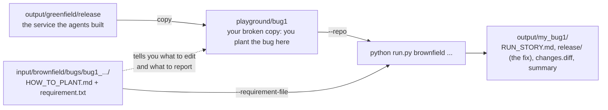

# Agentic Software Engineering System

A working prototype that turns a **software requirement** into a **reviewable engineering outcome**: a plan, code, an API contract, tests, documentation and a
structured engineering summary. A lead agent plans the work, specialised agents write the code and the tests, a validator that actually *runs* things judges the result,
and humans approve at the points that matter.

> Python 3.9+ (developed on 3.10), **standard library only**: nothing to install. It needs **one model** from any provider (Azure, OpenAI-compatible, Anthropic, or a CLI) for
> the agents. The test suite needs no model.

---

## 1. The ask (in plain English)

The assignment: *design and build an agentic system that carries a requirement through the software lifecycle*. It is **not a chatbot**. You hand over a requirement and get back
engineering work products. It must show:

| The assignment asks for | Where this project shows it |
|---|---|
| Understand the requirement, find ambiguity, restate it as an engineering problem | requirement analyst; the clarification pause ([use case 3](docs/usecases/03_AMBIGUOUS.md)) |
| Break work into tasks with dependencies and an order | the lead agent's plan, checked by the harness (`output/*/plan.json`) |
| Reason about existing code (impacted modules, APIs, data flows) | codebase analyst ([use case 2](docs/usecases/02_BROWNFIELD.md)) |
| Orchestrate: parallelism, coordination between steps, error handling and recovery | the loop: retries, repair rounds, degrade, resume, fault injection |
| Produce code, API contracts, tests, docs | the generated URL shortener ([use case 1](docs/usecases/01_GREENFIELD.md)) |
| Validate and control risk: risks, trade-offs, test strategy, guardrails | the validator, risk register, sandbox, protected tests |
| **Controlled autonomy**: agents act alone, humans oversee | three human gates; every decision audited |
| A final structured engineering summary | `ENGINEERING_SUMMARY.md` in every run |

The mandatory example: *"Build a scalable URL shortener service with APIs, persistence, and analytics."*

## 2. The use cases we cater to

| # | Use case | Example requirement | Command | Read |
|---|---|---|---|---|
| 1 | **Greenfield**: build something new | "Build a scalable URL shortener service with APIs, persistence, and analytics." | `python run.py greenfield` | [01_GREENFIELD](docs/usecases/01_GREENFIELD.md) |
| 2a | **Brownfield: bug fix. Your first brownfield test** | "Fix the bug where link stats report unique_visitors equal to the total number of clicks" | `python run.py brownfield --verify` | [02_BROWNFIELD](docs/usecases/02_BROWNFIELD.md) |
| 2b | *Advanced:* brownfield **enhancement** (changes the API; **can fail**, a legitimate result) | "Add support for expiring short links ... return 410 Gone" | `python run.py enhancement` | same |
| 2c | *Advanced:* brownfield **refactor** | "Refactor the stats query code into small helpers, without changing behaviour" | `python run.py refactor --verify` | same |
| 2d | *Advanced:* brownfield **tests / docs** | "Improve test coverage for link deletion and alias validation" | `python run.py tests --verify` | same |
| 3 | **Ambiguous requirement** | "Make the link service faster and more secure." | `python run.py ambiguous` | [03_AMBIGUOUS](docs/usecases/03_AMBIGUOUS.md) |

### Inputs and outputs

Each scenario has an **input** in [`input/`](input/README.md) and an **output** in `output/` with the same name:

```
input/<scenario>/requirement.txt   -->   python run.py <command>   -->   output/<scenario>/
```

| Scenario | Input | Output |
|---|---|---|
| greenfield | `input/greenfield/requirement.txt` (one sentence) | `output/greenfield/` (the service, tests, docs, contract, summary) |
| brownfield (bug fix) | `input/brownfield/requirement.txt` (a bug report) **plus existing code**: a copy of the greenfield service with one bug planted | `output/brownfield/` (the fix as `release/changes.diff`, new tests, proof, summary) |
| enhancement, refactor, tests | `input/enhancement/`, `input/refactor/`, `input/tests_improvement/` + the existing service | `output/enhancement/`, `output/refactor/`, `output/tests_improvement/` |
| ambiguous | `input/ambiguous/requirement.txt` + `answers.json` (the human's answers) | `output/ambiguous/` (clarification questions, then `docs/PROPOSAL.md`) |

Each run also copies the input it used into `output/<scenario>/input/`, so an output always shows what produced it. Use your own requirement with
`--requirement-file my.txt`, or `python run.py custom "<text>" [--repo <path>]`.

**Brownfield, in one sentence:** the URL shortener already exists and a person asks for a change; the agents work out *where* in the existing code it belongs, change it
minimally, and prove it. **The agents do not discover bugs**: for the bug-fix demo the system plants one bug in a copy of the shortener, and the request reports it in plain English.
Start with 2a (one command, one verify); treat 2b to 2d as advanced.

The system detects the **kind** of change from the wording. The kind decides which agents may be used and what proof the validator demands (for example, a refactor must leave the API
identical, a tests-only change may not touch production code, a bug fix's new tests must fail on the buggy code).

## 3. How it works in one picture


In plain English: the system **discovers** what is being asked (and what already exists), a **lead agent plans** the tasks, the **harness checks the plan** against fixed rules, a **human approves it**, the agents **do the work** in parallel,
a **validator runs** syntax, behaviour probes, the tests, API diffs and test-integrity checks, failures are **sent back to whoever is responsible**, and only after a **human approves the result** are files released.

## 4. How the agents are designed

**The principle:** *the model chooses structure and order; the harness owns permissions, verification and release.* Models are treated as untrusted producers.

There are exactly **four model-backed agents**, each a Markdown file in [`agentic/agents/`](agentic/agents/) so its behaviour can be reviewed without reading code. Everything else is a **step**: deterministic, unit-tested Python with no model call.

| Agent | What it does | What it cannot do |
|---|---|---|
| `project_lead` | proposes the task plan; each turn picks which ready tasks start | write files, widen a permission, approve anything |
| `requirement_analyst` | normalises the requirement, finds vague terms (rules; the model may only *add* questions) | remove or change a rule-based result |
| `code_author` | writes the service (greenfield) or proposes minimal anchored edits (change) | edit tests; write outside its scope |
| `spec_tester` | writes tests from the **specification only**, never seeing the code | read the code; edit existing tests (except one narrow, human-approved case) |

**Controlled autonomy, concretely:**
- *Autonomy:* after the plan is approved, about ten tasks run in parallel with retries and self-repair, with no human in the loop.
- *Control:* three human gates (the plan; any amended existing test; the release), a sandbox, write scopes that come from a catalog the model cannot edit, bounded loops, a secret scan, and an audit log of every decision.
- *Nothing grades itself:* the validator is code; tests come from a separate model call; the author cannot edit the tests that judge it; a bug fix's tests must fail on the old code.

The five layers, the steps, how agents coordinate, the guardrails, failure handling and the block diagram are in **[docs/ARCHITECTURE.md](docs/ARCHITECTURE.md)**.

## 5. Prerequisites and quick start

### Prerequisites: connect one model (do this first)

The agents need **one model** that can return JSON. You do **not** need Azure Foundry: any of the providers below works. Everything is configured in a `.env` file next to `run.py`.

| You need | Details |
|---|---|
| Python 3.9+ | nothing to install: the project uses the standard library only |
| One model provider | an API key (or a local model server) for **one** of: Azure AI Foundry, OpenAI, Anthropic (Claude), GitHub Models, OpenRouter, a local model (Ollama, LM Studio, vLLM), or a tool's command line |
| Internet access | for the model API (not needed for a local model) and, for `--shorten`, to resolve the host of your URL |

**1. Create your `.env`:** `copy .env.example .env`, then open it and fill in **one** block. Lines starting with `#` are ignored, so uncomment the lines you use. Never commit `.env` (it is already in `.gitignore`).

**2. What the file looks like** (pick the one that matches what you have; no quotes needed):

```
# Azure AI Foundry / Azure OpenAI
AZURE_AI_ENDPOINT=https://my-resource.services.ai.azure.com
AZURE_AI_DEPLOYMENT=my-deployment-name
AZURE_AI_API_KEY=xxxxxxxxxxxxxxxx
```

```
# Anthropic (Claude) API key
AGENTIC_PROVIDER=anthropic
ANTHROPIC_API_KEY=sk-ant-xxxxxxxxxxxxxxxx
AGENTIC_MODEL=claude-sonnet-5-5
```

```
# OpenAI API key (the same three settings work for OpenRouter and GitHub Models: only the base URL and key change)
AGENTIC_PROVIDER=openai
AGENTIC_BASE_URL=https://api.openai.com/v1
AGENTIC_MODEL=<a current chat model id from your account>
AGENTIC_API_KEY=sk-xxxxxxxxxxxxxxxx
```

```
# A local model, no cloud and no key (Ollama shown; LM Studio and vLLM only change the URL)
AGENTIC_PROVIDER=openai
AGENTIC_BASE_URL=http://localhost:11434/v1
AGENTIC_MODEL=<the model name you pulled>
```

Fill in only **one** block (or set `AGENTIC_PROVIDER` explicitly), so you know which model runs. A value that still starts with `<` counts as unfilled.
Use a **strong, current model**: a greenfield run asks for a whole service and 20+ tests, and small local models usually fail at the plan step. Claude Code, Codex, Cursor and Copilot are applications, not model APIs; to use one, see the command-line route in [docs/MODEL_SETUP.md](docs/MODEL_SETUP.md).

**3. Prove it works** before running anything else:

```powershell
python scripts/model_smoke.py
```

It checks the configuration, authentication, a JSON reply, and that the model can write valid Python in the system's real output format. It must end with a success message; if it does not, nothing else will work (the message says what to fix; see the troubleshooting table in [docs/MODEL_SETUP.md](docs/MODEL_SETUP.md)).

**No model at all?** You can still run the 273 framework tests, re-check saved outputs (`python scripts/verify_outputs.py`) and run an already-built service, but you cannot start a **new** agent run: the lead agent that plans is a model, and there is deliberately no hidden offline plan.

### Quick start

```powershell
copy .env.example .env                        # then fill in ONE model provider (see Prerequisites above)
python scripts/model_smoke.py                 # prove the model connection first
python run.py greenfield                      # the mandatory use case (about 9 minutes)
python run.py brownfield --verify             # your first brownfield test: plant a bug, fix it, prove it (3 to 5 minutes)
python scripts/verify_outputs.py              # re-check every scenario from the files on disk, re-running each release's tests
python -m unittest discover -s tests -t .     # framework tests: 273, offline, about 5 minutes, no model needed
```

Then open `output/greenfield/RUN_STORY.md` (what happened) and `output/greenfield/DEMO_RESULT.md` (the proof: a real long URL shortened by the service the agents built, then redirected back). To use the service yourself:

```powershell
cd output/greenfield/release
python -m shortener.server --port 8080
```

### Run and verify each use case

All commands run from the project folder in PowerShell. Every scenario calls the model (a few minutes each) except the framework tests. Add `--approve interactive` to any run to be the human at the gates (type `y` or `n`); the default `auto` approves and labels it `policy:auto`.
`python scripts/verify_outputs.py <scenario>` re-reads the files on disk and re-runs the released tests, so it does not trust the run's own report. A scenario you have not run says `NOT RUN`, which is not a failure.

#### Use case 1: Greenfield (build the URL shortener)

##### Test greenfield on any URL

This is the simplest end-to-end test of the agents: you give a URL, the agents plan, write, test and release a URL shortener, and the service **they built** returns a working short URL for it.

**Before you start:** `.env` has one model provider and `python scripts/model_smoke.py` succeeds ([docs/MODEL_SETUP.md](docs/MODEL_SETUP.md)). You need internet access (the service resolves the host of your URL). Nothing else: the agents build everything.

**Step 1. Run it** (about 9 minutes, uses the model). Replace the URL with yours:

```powershell
python run.py greenfield --shorten https://www.python.org/downloads/ --out output\my_greenfield
```

`--out` keeps your run apart from the committed `output/greenfield`. Useful variations:

| Want to... | Add |
|---|---|
| choose your own short name (3-32 letters, digits, `_` or `-`) | `--alias my-link` |
| shorten several URLs in one run | `--shorten <url1> --shorten <url2>` (the alias applies to the first) |
| approve the plan and the release yourself (type `y` or `n`) | `--approve interactive` |
| stop the service right after shortening | `--once` |
| change what the agents build (still a URL shortener) | `--requirement-file my_requirement.txt` |

To change what the agents build, write your own requirement and pass it in. It must stay a URL-shortener requirement and say so in words ("URL shortener", "link shortener" or "short link"): the code and test agents are given the URL-shortener interface spec (`agentic/agents/context/url_shortener_interface.md`), so you can change features, constraints and emphasis, not the domain. A requirement with no recognised domain is treated as an analysis request and produces a proposal, not code.

```powershell
Set-Content my_requirement.txt "Build a URL shortener service with a REST API, SQLite persistence, click analytics, and optional custom aliases." -Encoding utf8
python run.py greenfield --requirement-file my_requirement.txt --shorten https://www.python.org/downloads/ --out output\my_greenfield
```

**Step 2. Watch the agents.** In order, the terminal shows: the requirement understood; the lead agent's **task plan** (about 10 tasks and their dependencies) and the plan gate; each task starting and finishing (`code_author` and `spec_tester` run in parallel; you may see `task_retry`, `task_self_correct` or a repair round, which is the system working as designed); the validator's checks; the release gate. Open `output\my_greenfield\RUN_STORY.md` any time, even mid-run: it tells the same story in plain English and updates live.

**Step 3. Use the short URL.** The run ends with:

```
SHORTEN YOUR URL with the service the agents just built
long URL : https://www.python.org/downloads/
short URL: http://127.0.0.1:8080/Ab3dE9x
redirect : HTTP 302 -> https://www.python.org/downloads/   [OK, lands on your URL]
analytics for Ab3dE9x: total_clicks=1 unique_visitors=1

YOUR SHORT URL IS LIVE. Open it in your browser now (this terminal must stay open):
  http://127.0.0.1:8080/Ab3dE9x
     -> https://www.python.org/downloads/
Press Ctrl+C here to stop the service (the short URL stops working then).
```

Open the short URL in a browser: it lands on your page. **The short URL works only while this terminal is open**, because the service the agents built runs inside it. Press Ctrl+C when you are done.
Each browser visit is a click: read the analytics with the `Invoke-RestMethod` line the script prints.

**Step 4. Verify it really worked.**

| Check | What you should see |
|---|---|
| The run's status | `>> status: completed`, and `output\my_greenfield\release\` exists (it exists only after the release gate approved) |
| The redirect | the line `redirect : HTTP 302 -> <your URL>   [OK, lands on your URL]` (the service sent a `Location` header equal to exactly your URL) |
| The browser | the short URL opens your original page |
| The agents did the work | `RUN_STORY.md` (who did what), `ENGINEERING_SUMMARY.md` section 3 (the plan) and section 6 (every validation check with evidence) |
| The service's own tests | `cd output\my_greenfield\release; python -m unittest discover -s tests -t .` ends `OK` |

**What different URLs do** (the service's own rules, so a rejection is the service working correctly):

| You try | Expected |
|---|---|
| a normal public `https://` URL | `201`, a short URL, redirect `302` back to exactly your URL |
| the same URL with `--alias my-link` | the short URL ends in `/my-link`; reusing that alias gives `409 alias is taken` |
| `http://localhost/...`, a private address, `ftp://...`, a URL with `user:pass@`, text that is not a URL | rejected with `400` and the service's own message (only public http(s) hosts are accepted) |
| a URL longer than 2048 characters | rejected with `400` |

**If it goes wrong**

| Symptom | Cause and what to do |
|---|---|
| The short URL says "failed to load" | the service has stopped: you used `--once`, pressed Ctrl+C, or closed the terminal. Re-run the greenfield command (without `--once`) and keep that terminal open while you use the new short URL. Links from a stopped service are gone |
| `status: failed`, nothing shortened | the model produced output the harness rejected and the bounded retries ran out. Open `events.jsonl`, search `task_failed`, and re-run (models are not deterministic, so a second attempt often passes). Two causes seen in practice, both now sent back to the model as feedback to retry: a null byte in generated code, and secret-like text such as `token = "abcdefgh12"` |
| `rejected_at_plan` / `rejected_at_release` | you answered `n` at a gate (`--approve interactive`). Nothing is released or shortened |
| `no released service to use` | the run did not release; see `RUN_STORY.md` for why |
| `[REJECTED] ... HTTP 400` | the service refused that URL (see the table above) |
| `port 8080 is busy, using NNNN` | harmless: use the port the script prints |
| `could not remove ... release` | an earlier service is still running, or OneDrive is syncing; Ctrl+C it and retry |

`--shorten`, `--alias` and `--once` work with `greenfield` only. Every `--shorten` run goes through the agents: they plan, build, test and release the service, and only then is your URL shortened with it.

**No URL to test? Run the default build** (the mandatory requirement: "Build a scalable URL shortener service with APIs, persistence, and analytics."):

```powershell
python run.py greenfield                         # about 9 minutes
python scripts/verify_outputs.py greenfield      # expect: "greenfield OK" and the released tests re-run "... OK"
```

| What to verify | Where |
|---|---|
| Status is `completed`; `release/` exists | last lines of the terminal; `summary.json` |
| A long URL became a short URL and redirected back | `output/greenfield/DEMO_RESULT.md` |
| The plan has about 10 tasks, some in parallel | `ENGINEERING_SUMMARY.md` section 3; `plan.json` |
| Every validation check passed, with evidence | `ENGINEERING_SUMMARY.md` section 6 |

#### Use case 2: Brownfield (change existing code)

Brownfield changes the service greenfield built. **The agents do not discover bugs: you plant one, and a plain-English bug report is the request.** They work out *where* in the existing code it lives, fix it minimally, and the validator proves it. Your original `release/` is never modified.

##### Test brownfield by planting a bug yourself

Use the five ready-made bugs in [`input/brownfield/bugs/`](input/brownfield/bugs/). You break a copy of the
service by hand (a one-line edit), give the agents the bug report, and watch them find and fix it. Each bug folder has:

| File | What it is |
|---|---|
| `HOW_TO_PLANT.md` | the file to open, the exact text to find, what to change it to, and which test must go red |
| `requirement.txt` | the bug report for the agents: the symptom only, never the file or the fix |

| # | Folder | You change | The symptom the agents are told |
|---|---|---|---|
| 1 | [bug1_short_alias](input/brownfield/bugs/bug1_short_alias/HOW_TO_PLANT.md) | alias length `{3,32}` to `{1,32}` | aliases shorter than 3 characters are accepted |
| 2 | [bug2_reserved_alias](input/brownfield/bugs/bug2_reserved_alias/HOW_TO_PLANT.md) | remove `admin` from the reserved names | the alias `admin` can be registered |
| 3 | [bug3_deleted_link_still_works](input/brownfield/bugs/bug3_deleted_link_still_works/HOW_TO_PLANT.md) | deleted links no longer filtered out | a deleted short link still redirects |
| 4 | [bug4_stats_days_limit](input/brownfield/bugs/bug4_stats_days_limit/HOW_TO_PLANT.md) | stats `days` limit 90 to 9000 | `days=365` is accepted instead of a 400 |
| 5 | [bug5_rate_limit_off](input/brownfield/bugs/bug5_rate_limit_off/HOW_TO_PLANT.md) | rate limiter always says yes | unlimited link creation, never a 429 |

Do **one bug at a time**, easiest first (start with bug 1). Steps for a first-time user:

1. **Setup (once).** `copy .env.example .env`, fill in one model provider ([docs/MODEL_SETUP.md](docs/MODEL_SETUP.md)), then `python scripts/model_smoke.py` must succeed.
2. **Make sure the working service exists.** `Test-Path output\greenfield\release\shortener` must print `True`. If not, run `python run.py greenfield` once (about 9 minutes).
3. **Copy it into a playground** (`playground/` is git-ignored). Use `bug2`, `bug3`, ... for the other bugs:
   ```powershell
   New-Item -ItemType Directory playground -Force | Out-Null
   Copy-Item output\greenfield\release playground\bug1 -Recurse
   ```
4. **Plant the bug.** Open the file named in the bug's `HOW_TO_PLANT.md` (bug 1: `playground\bug1\shortener\validation.py`), search for the *Find* text, change it as described, save.
   The model writes the service, so your generated file may differ slightly: if the *Find* text is missing, look for the nearest equivalent line or pick another bug.
5. **Prove the bug is real (the tests go red).**
   ```powershell
   cd playground\bug1; python -m unittest discover -s tests -t .; cd ..\..
   ```
   You should see `FAILED (failures=...)` including the test the bug page names. The original (`output\greenfield\release`) should be green.
6. **Let the agents fix it** (3 to 5 minutes; add `--approve interactive` to be the human at the gates):
   ```powershell
   python run.py brownfield --repo playground\bug1 --requirement-file input\brownfield\bugs\bug1_short_alias\requirement.txt --out output\my_bug1 --verify
   ```
   `--repo` is your broken copy, `--requirement-file` the bug report, and `--out` keeps this away from the committed `output/brownfield`. The last line should be `>> VERIFIED: this run really works.`
7. **Check what they did.**

   | Look at | You should see |
   |---|---|
   | `output\my_bug1\RUN_STORY.md` (updates live while it runs) | the plan, which agent did what, the exact diff, every validation check in plain English |
   | `output\my_bug1\release\changes.diff` | a **small** diff that undoes your edit, not a rewrite |
   | `output\my_bug1\ENGINEERING_SUMMARY.md` | section 2 (how the agents located the code) and the line **Bug-fix proof** |
   | `output\my_bug1\DEMO_RESULT.md` | the bug before and after |

   Then run the fixed tests yourself: `cd output\my_bug1\release; python -m unittest discover -s tests -t .; cd ..\..\..`

   **The agents worked if:** status is `completed` with a `release/` folder; the **new tests fail on your buggy copy** and pass on the fix; the whole suite is green afterwards; and `changes.diff` touches only what the bug needed.
   If status is `failed`, that is information, not a broken tool: search `events.jsonl` for `task_failed` and `FAIL`, then re-run (models are not deterministic, so a second attempt often passes).
8. **Next bug, or clean up:** `Remove-Item playground -Recurse -Force` removes every planted copy.

| Troubleshooting | Cause and fix |
|---|---|
| Tests are red **before** you edit | the service already fails some tests on your machine. Note the count; after planting, it must go **up** and include the named test. Otherwise regenerate with `python run.py greenfield` |
| Tests stay green after your edit | the edit did not take effect: wrong folder (`output\...` instead of `playground\...`) or file not saved |
| `could not remove ... release` | a server you started is still running, or OneDrive is syncing; stop it (Ctrl+C) and retry |
| `plan_rejected` | the lead agent could not produce a valid plan in 3 tries; re-run |

**No time to edit anything?** `python run.py brownfield --verify` plants a built-in bug (stats report `unique_visitors` equal to total clicks) in a copy of the service and runs the same fix flow, about 3 to 5 minutes. The final line should be `>> VERIFIED: this run really works.` Read `output/brownfield/RUN_STORY.md` and `release/changes.diff`.

#### Use case 3: Ambiguous requirement (the system must ask, not guess)

"Make the link service faster and more secure." has vague terms and no numbers, so the run **pauses with questions and writes no code**. This takes two commands.

```powershell
python run.py ambiguous                                          # step 1: pauses. Status needs_clarification (exit code 0, not a failure)
python run.py ambiguous --answers input/ambiguous/answers.json   # step 2: a human answers, the run continues
python run.py ambiguous --assume-defaults                        # or step 2 alternative: accept documented defaults
python scripts/verify_outputs.py ambiguous
```

| What to verify | Where |
|---|---|
| Step 1 produced questions, each with a default, and **no** `release/` | `output/ambiguous/clarifications.json` |
| Step 2 ends `completed` and releases a proposal, not code | `output/ambiguous/release/docs/PROPOSAL.md` |
| The proposal has measurable objectives, options with trade-offs, a gap analysis against the existing code, and a validation plan | `PROPOSAL.md` |
| The answers (or defaults, marked "needs confirmation") are recorded | `ENGINEERING_SUMMARY.md`; `summary.json` |

#### Control demos and framework tests

```powershell
python run.py greenfield --approve reject:release_approval --out output/veto_demo   # human veto: work done, status rejected_at_release, no release/
python run.py greenfield --inject transient:spec_tester:2 --out output/retry_demo   # retry with backoff: task_retry events in events.jsonl
python run.py agents                                                                # lists agents and steps; ends "specs and registered agents are consistent"
python -m unittest discover -s tests -t .                                           # 273 tests, offline, about 5 minutes, no model
```

Everything else (more failure demos, resume, a five-minute demo script, troubleshooting) is in
**[docs/HOW_TO_RUN_AND_VERIFY.md](docs/HOW_TO_RUN_AND_VERIFY.md)**. No Azure Foundry? **[docs/MODEL_SETUP.md](docs/MODEL_SETUP.md)** covers OpenAI, Claude, GitHub Models, local models and a tool's CLI.

## 6. What a run produces, and how to investigate it

Take the mandatory use case. After `python run.py greenfield` finishes, the terminal prints where everything is:

```
>> status: completed
>> run story (plain English, what happened and why): output\greenfield\RUN_STORY.md
>> demo result (the service really used: long URL -> short URL -> redirect): output\greenfield\DEMO_RESULT.md
>> input used: output\greenfield\input
>> engineering summary: output\greenfield\ENGINEERING_SUMMARY.md
>> released artifacts:  output\greenfield\release
```

### The folder, at a glance

```
output/greenfield/
├── RUN_STORY.md             READ FIRST: the run in plain English, stage by stage
├── DEMO_RESULT.md           THE PROOF: a real long URL shortened by the service the agents built
├── ENGINEERING_SUMMARY.md   THE FORMAL REPORT: plan, rationale, artifacts, validation, risks, approvals, limits
├── release/                 THE PRODUCT: the validated service (only exists if a human approved the release)
│   ├── shortener/             the service code (written by the code_author agent)
│   ├── tests/                 the test suite (written by the spec_tester agent, from the spec only)
│   ├── openapi.json           the API contract (all code and tests are built against it)
│   ├── schema.sql             the database schema
│   ├── docs/                  ADR.md, ARCHITECTURE.md, RISKS.md, TESTING.md
│   └── README.md, Dockerfile, pyproject.toml, .gitignore
├── input/requirement.txt    a copy of exactly what this run was given
├── plan.json                the task plan the lead agent proposed and the harness accepted
├── events.jsonl             the complete audit log: every decision, one JSON line each
├── summary.json             status and gate decisions, for programs
├── state.json               the checkpoint that lets --resume continue a stopped run
└── workspace/               the sandbox the agents wrote into (internal; release/ is the validated copy of it)
```

### What each artifact is, who made it, and when to open it

| Artifact | What it is | Made by | Open it when you want to... |
|---|---|---|---|
| **`RUN_STORY.md`** | The whole run told in order, in plain English: what was asked, the lead agent's plan, which **AGENT (model)** or plain-Python **step** acted, what each validation check proves, the human gates, and the result. Written live while the run executes. | the harness (`narrator.py`) | understand what happened and why. **Start here.** |
| **`DEMO_RESULT.md`** | After the release, the service is really started, two real long URLs are shortened, the short URLs are followed and the analytics are read. For a bug fix it also shows the bug **before and after**. It is the only place a long URL and its short URL appear side by side. | the harness (`demo.py`) | **see it work**. The short URLs stop resolving once the demo ends. |
| **`release/`** | **The product**: everything the agents produced and the validator approved, ready to run. It exists only after the release gate. | agents and steps (below) | run it, read it, ship it. This is the real deliverable. |
| `release/shortener/` | The service: HTTP layer, business rules, storage, cache, analytics, rate limiting, validation, server. File names inside differ between runs, because the model chooses the layout. | `code_author` (model) | read how it is built, or start it with `python -m shortener.server --port 8080` |
| `release/tests/` | The test suite, written from the contract by a **separate** model call that never saw the code. | `spec_tester` (model) | run `python -m unittest discover -s tests -t .` |
| `release/openapi.json` | The API contract: every route, request, response and status code. | `contract_designer` (step) | see exactly what the service promises |
| `release/schema.sql` | The database tables and columns. | `data_modeler` (step) | see the data model |
| `release/docs/ADR.md` | The architecture decisions, each with why it was chosen and its trade-off (random base62 codes, 302 vs 301, async analytics, ...). | `architect` and `doc_writer` (steps) | learn why it is designed this way |
| `release/docs/RISKS.md`, `ARCHITECTURE.md`, `TESTING.md` | The risks and mitigations, the design of the generated service, the test strategy. | `risk_assessor`, `doc_writer` (steps) | review risk and design |
| `release/README.md`, `Dockerfile`, `pyproject.toml`, `.gitignore` | Packaging for the generated service. | `doc_writer` and fixed templates (no model) | run it or containerise it |
| **`ENGINEERING_SUMMARY.md`** | The formal engineering report the assignment asks for. Sections: 1 requirement understanding, 3 implementation plan and rationale (with the task table and graph), 4 orchestration evidence (retries, repair rounds, validation per generation, model usage), 5 generated artifacts (every file with its producer and checksum), 6 validation (every check and its evidence), 7 risks and trade-offs, 8 approval audit, 9 assumptions and limits. (A brownfield run adds section 2, codebase reasoning.) | `summarizer` (step) and the harness | review the whole engineering outcome in one document |
| `input/requirement.txt` | A copy of the requirement this run answered. | `run.py` | see exactly what produced this output |
| `plan.json` | The tasks the lead agent proposed, with the tool and dependencies of each. | `project_lead` (model), checked by the harness | see the decomposition |
| `events.jsonl` | The complete audit log: plan, decisions, retries, repair rounds, every validation check and every gate. | the harness | answer a precise question ("why did this task run twice?") |
| `summary.json`, `state.json` | Machine-readable status and the checkpoint behind `--resume`. | the harness | scripts and resuming; ignore otherwise |
| `workspace/` | The sandbox the agents wrote into. `release/` is the validated copy of it. | the harness | ignore it |

### A five-minute way to investigate a run

1. **`RUN_STORY.md`** (3 minutes): read the stages. Note the lead agent's plan and the two agents that call a model (`code_author`, `spec_tester`); everything else is plain Python.
2. **`DEMO_RESULT.md`** (1 minute): confirm a long URL became a short URL and redirected back.
3. **`release/openapi.json`, then `release/shortener/`** : the contract first, then the code that implements it. Run `python -m unittest discover -s tests -t .` inside `release/`.
4. **`ENGINEERING_SUMMARY.md`** sections 3 and 6: the plan table and every validation check with its evidence.
5. **`events.jsonl`** only if something needs explaining.

### Questions, and where the answer is

| Question | Look at |
|---|---|
| Did it work? | the **Result** section of `RUN_STORY.md`; `DEMO_RESULT.md`; or `python scripts/verify_outputs.py greenfield` (re-runs the released tests) |
| What did the agents decide and do? | `RUN_STORY.md` stages 2 and 3; `plan.json` |
| Which agent wrote which file? | `ENGINEERING_SUMMARY.md` section 5, column "Produced by" |
| Why is it designed this way? | `release/docs/ADR.md` |
| Was anything retried or repaired? | `RUN_STORY.md` stages 3 and 4; `ENGINEERING_SUMMARY.md` section 4 |
| How was it checked? | `RUN_STORY.md` stage 4; `ENGINEERING_SUMMARY.md` section 6 |
| What are the risks? | `release/docs/RISKS.md`; `ENGINEERING_SUMMARY.md` section 7 |
| Who approved it? | `ENGINEERING_SUMMARY.md` section 8; `summary.json` (gates) |
| Can I run it myself? | `release/README.md`, or the "Try it yourself" commands at the end of `DEMO_RESULT.md` |

The other scenarios produce the same folder shape. A **brownfield** run adds `release/changes.diff` (the exact change the agent made), a codebase-reasoning section in the summary, and, for the bug fix,
a before-and-after table in `DEMO_RESULT.md`. An **ambiguous** run produces `clarifications.json` first and then `release/docs/PROPOSAL.md` instead of code.

## 7. What is in each folder of the project

| Folder or file | What it is |
|---|---|
| `run.py` | the command line: `greenfield`, `brownfield`, `enhancement`, `refactor`, `tests`, `ambiguous`, `custom`, `demo`, `agents` |
| `agentic/harness/` | **the harness**: `harness.py` (flow), `lead.py` (lead agent and plan check), `loop.py` (execution), `tools.py` (tool catalog), `guardrails.py` (sandbox), `approvals.py` (gates), `core.py` (tasks, errors, events, blackboard, fault injection), `report.py` (summary), `narrator.py` (writes `RUN_STORY.md` live), `demo.py` (uses the released service and writes `DEMO_RESULT.md`) |
| `agentic/agents/` | **the four agents** as Markdown, plus `context/` (the URL shortener interface spec given to the code and test agents) |
| `agentic/steps/` | the deterministic steps: `analysis.py` (requirement and codebase analysis), `design.py` (architecture, contract, schema, risks, strategy), `build.py` (documentation; an offline reference generator used only by tests), `validate.py` (the validator and summariser) |
| `agentic/providers.py` | **the transport** (layer 5): one `complete_json(system, prompt)` contract with four backends (azure, openai-compatible, anthropic, command), provider selection, `.env` loading, JSON extraction. Knows nothing about this project |
| `agentic/authoring_agents.py` | **the behaviour** of `code_author` and `spec_tester` (layer 3): builds prompts, parses and bounds replies, rejects bad output with feedback, writes through the sandbox, handles test amendments. Reaches a model only through the `providers.py` contract |
| `agentic/agent_specs.py`, `knowledge.py` | loads and checks the agent files; ADRs, risk catalogues, capacity model (the "judgement" data) |
| `agentic/api.py`, `infra/`, `Dockerfile` | optional HTTP service with remote approval gates and its Azure deployment (not yet run in Azure) |
| `agentic/templates/` | sources for the offline reference generator; test support only, not a use case |
| `tests/` | 273 framework tests: harness, lead, loop, guardrails, agents, test-integrity policies, end-to-end runs with fault injection. A scripted stand-in plays the model |
| `scripts/` | `model_smoke.py` (check the model), `verify_outputs.py` (check every scenario), `seed_bug.py` (plant the demo bug), `demo_service.py` (shorten two sample URLs with a finished run's service and write `DEMO_RESULT.md`), `shorten_url.py` (internal helper: `run.py greenfield --shorten` calls it after the agents release the service), `cloud_e2e.py` (test a deployed service) |
| `input/` | **what you give the system**: one folder per scenario with `requirement.txt` (and `answers.json` for the ambiguous case), plus `brownfield/bugs/` (five bugs to plant yourself). Edit these to try your own. See `input/README.md` |
| `playground/` | **your scratch area for testing** (you create it; git-ignored): broken copies of the service that you edit by hand, one per bug. The system reads it but never writes to it. Safe to delete |
| `output/` | **what the system produces**, one folder per run (see below; `--out` names it). Safe to delete; regenerate by running the scenario |
| `docs/` | the documentation (see section 8) |
| `.env`, `.env.example` | your model settings (never commit `.env`) |

**`output/<scenario>/`** always has the same shape: **`RUN_STORY.md` (open this first: the run in plain English, written live)**, **`DEMO_RESULT.md` (the visible payoff: the released service really used, with a long URL shortened and redirected)**, `ENGINEERING_SUMMARY.md` (the formal report), `plan.json` (the accepted task plan), `events.jsonl` (audit log), `state.json` (checkpoint),
`summary.json` (status and gate decisions), `input/` (a copy of exactly what this run was given), and `release/` (the validated files; **it exists only if the human release gate approved**). Folders: `greenfield` and `brownfield` (bug fix, from the
planted-bug copy `brownfield/input/existing_code_with_bug`) are committed as evidence. `enhancement`, `ambiguous`, `refactor` and `tests_improvement` do not exist until you run their command (the ambiguous output also has `clarifications.json`).

### How `input/`, `playground/` and `output/` fit together when you test



| Folder | Role in a test | Who writes it | In git? |
|---|---|---|---|
| `input/` | the question you ask: requirements, answers, and the bug recipes | you (edit) | yes |
| `playground/` | the patient: a copy of the service that you break by hand | you (`Copy-Item`); never changed by a run | no (git-ignored) |
| `output/<name>/` | the answer: everything a run produced, including `release/` | the system | `greenfield` and `brownfield` yes; your own (`my_bug1`, `my_greenfield`, ...) show up as new, untracked files |

Rules of thumb: the system never modifies the folder you pass with `--repo` (it works on a copy inside its own `output/<name>/workspace`), so you can re-run against the same broken copy as often as you like.
Give every test its own `--out` name so one run does not overwrite another (or the committed evidence). Clean up with `Remove-Item playground -Recurse -Force`, and delete `output\my_*` when you are done. If you do not want your own runs in `git status`, add `output/my_*/` to `.gitignore`.

## 8. Documentation map

| Read | For |
|---|---|
| [docs/ARCHITECTURE.md](docs/ARCHITECTURE.md) | the design in plain language: a run start to finish, who does what, guardrails, validator, failure handling, the use cases, decisions, limits |
| [docs/usecases/01_GREENFIELD.md](docs/usecases/01_GREENFIELD.md), [02_BROWNFIELD](docs/usecases/02_BROWNFIELD.md), [03_AMBIGUOUS](docs/usecases/03_AMBIGUOUS.md) | each use case: who takes part, design flow, test cases, decisions |
| [docs/MODEL_SETUP.md](docs/MODEL_SETUP.md) | connecting a model: complete `.env` examples for every provider, running without Foundry |
| [docs/HOW_TO_RUN_AND_VERIFY.md](docs/HOW_TO_RUN_AND_VERIFY.md) | the reference: re-checking results, advanced scenarios, failure demos, a demo script, troubleshooting |
| [docs/TESTING.md](docs/TESTING.md) | the three levels of testing and the test inventory (273 tests) |
| [docs/README.md](docs/README.md) | the documentation index: which document answers which question |
| [docs/AZURE_DEPLOYMENT.md](docs/AZURE_DEPLOYMENT.md) | optional hosted deployment (untested in Azure) |

## 9. Status and honest limits

**Verified live** (one Azure AI Foundry deployment, with the models writing the code and tests): greenfield (about 9 min, 10 model calls, 14 black-box probes, 73 tests green, no repair needed in the committed run);
the ambiguous requirement; the bug fix (new tests proven to fail on the buggy code); a refactor; a tests-only change; the link-expiry enhancement. The enhancement failed on its first attempt after the
test-update policy was added and passed on the second, so **two attempts is not a pass rate**.

**Not verified:** providers other than Azure (wire format tested with mocked HTTP only), a tool's CLI as a provider, and the Azure Container Apps deployment.

Limits, stated plainly (the full list is in [docs/ARCHITECTURE.md](docs/ARCHITECTURE.md), section 12):
- **Runs are not reproducible end to end.** Models write the plan, the code and the tests; two runs can differ, and a run can still end `failed` if the model's output is rejected after the bounded retries. Re-running often passes. The committed `output/` is one run's evidence.
- **No model, no new run.** The lead agent is a model and there is deliberately no hidden offline plan. Without a model you can still run the tests, re-check saved outputs and run the generated service.
- **The validator proves "consistent and tested", not "right for the business".** The amendment check counts; it does not understand, so the human gate is the backstop.
- **The generated service is a prototype** (SQLite, an in-process cache, a per-node rate limiter). A short URL from `--shorten` works only while its service is running.
- `--generator template` is an offline reference mode used by the test suite. It is not a use case.
