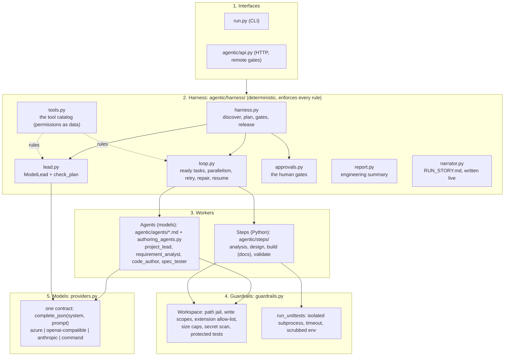
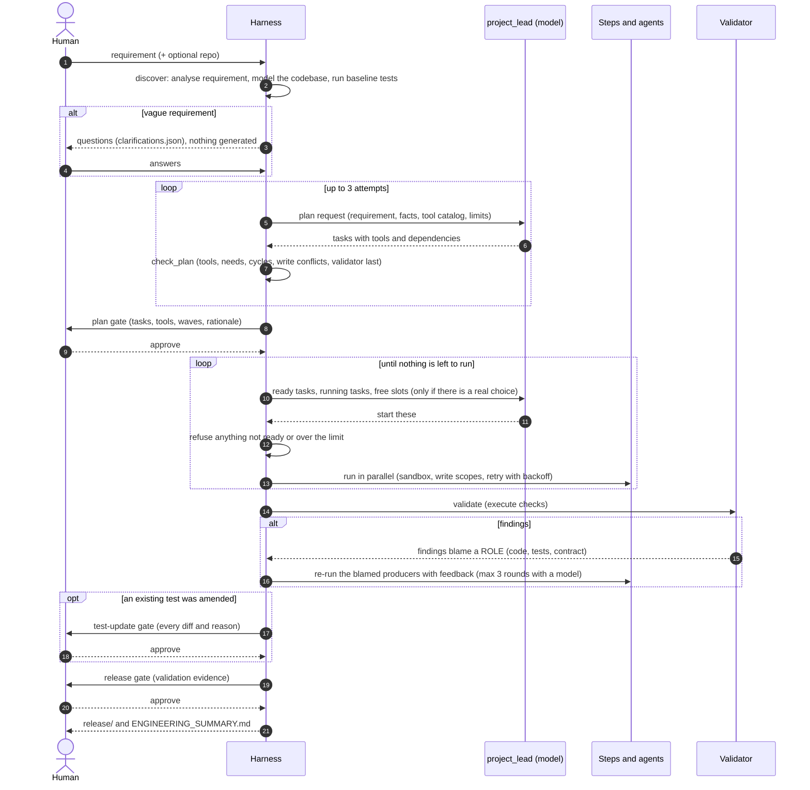
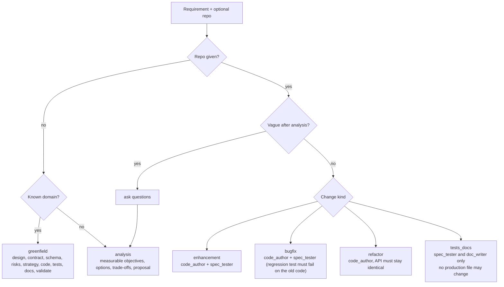
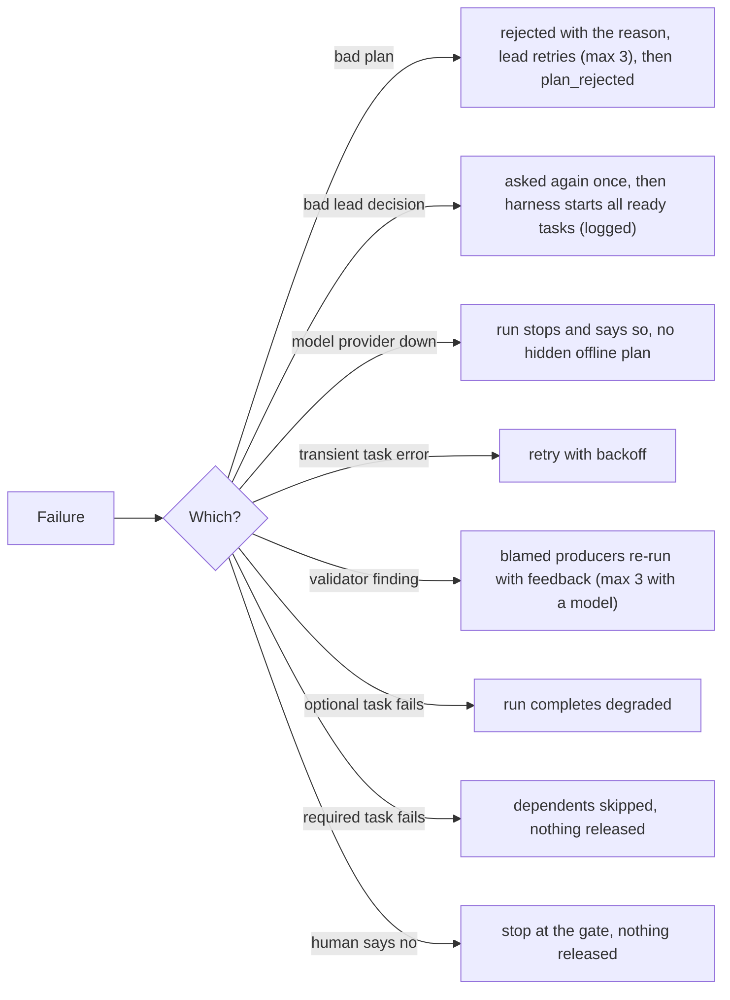

# Architecture and design

The single design document. It explains the system as a whole; each use case then has its own page ([usecases/](usecases/)). If you are new, read the
[root README](../README.md) first for the problem and the use cases, then this page, then the use case you care about.

**Vocabulary used everywhere**

| Term | Meaning |
|---|---|
| **Lead agent** (`project_lead`) | a model that proposes the task plan and, each turn, picks which ready tasks start. It can only choose; it cannot write files or approve anything |
| **Harness** | plain Python that owns everything with consequences: plan checking, permissions, the sandbox, retries, repair, validation, the human gates, release |
| **Agent** | a model with a role, limits and a prompt, defined in `agentic/agents/*.md`. There are four: `project_lead`, `requirement_analyst`, `code_author`, `spec_tester` |
| **Step** | a deterministic Python work unit (`agentic/steps/`): design, analysis, docs, validation. Not an agent: no model call |
| **Tool** | the name a plan uses for an agent or a step. The **tool catalog** (`harness/tools.py`) says what each tool needs, provides, may write and may do |
| **Task** | one use of a tool in a plan: an id, a tool, the tasks it waits for |
| **Blackboard** | the shared record of facts (`contract`, `schema`, `code`, `tests`, ...) that tasks publish and consume. Workers never call each other |
| **Gate** | a point where a human must approve: plan, an amended existing test, release |

---

## 1. The idea in 60 seconds

The assessment asks for an agentic system that takes a requirement to a reviewable engineering outcome under **controlled autonomy**. The thesis:

1. **Models are untrusted producers.** They may be wrong, flaky or manipulated by the input text.
2. **A model chooses structure and order; the harness owns permissions, verification and release.** The lead plans, but `check_plan` rejects any plan that breaks a catalog rule, and write scopes always come from the catalog.
3. **Quality is measured by executing things**: parse the AST, run the tests, diff the API, drive the service black-box, run the new tests against the old code. Never "does this look right?" asked of a model.
4. **Humans own the irreversible decisions**: approve the plan before work starts, approve any amended existing test, approve the validated result before release.
5. **Every claim has evidence in a file:** `events.jsonl` (audit), `state.json` (checkpoint), `ENGINEERING_SUMMARY.md` (the deliverable).

It is not a chatbot or a prompt in a loop, and it is not free-form agents chatting. The model does the creative work inside a frame the harness enforces.

## 2. The system at a glance

Five layers; each only calls the one below it.



### 2.1 One run, end to end



### 2.2 How a request becomes a plan shape



### 2.3 What happens when something goes wrong



## 3. How an agent is designed

An **agent** is a model with a role, limits and a prompt. It is defined by a Markdown file, `agentic/agents/<name>.md`, so its behaviour can be read and
reviewed without reading code. A file has a header of facts and five sections:

```
---
name: spec_tester            <- must match the registered worker (a test checks this)
title: Spec Tester
kind: llm | hybrid           <- llm = a model writes artifacts; hybrid = rules do the work, a model may only ADD to the result
stage: understand | plan | build
plans: [greenfield, llm_change]      <- which plan types may use it
inputs: [...]   outputs: [...]       <- facts it reads and publishes on the blackboard
writes: [tests/*, tests/test_change_*.py]   <- documentation of its write scope
---
## Role              what it is for
## Responsibilities  what it does, step by step
## Guardrails        what it may not do (enforced by code, not by this text)
## Failure handling  what happens when it fails
## System prompt     the only text that reaches the model as its system message
```

**The file describes; the harness enforces.** The Markdown cannot grant permission: write scopes come from the tool catalog, and every file an agent produces goes through the sandbox.
Only the *System prompt* section reaches a model. `agent_specs.py` loads and validates the files; `python run.py agents` checks they match the registered workers; a test fails if a file names a vendor.

| Agent | Kind | Stage | Reads | Produces | Cannot |
|---|---|---|---|---|---|
| `requirement_analyst` | hybrid | understand | the raw text | the normalised requirement, ambiguities, assumptions | remove or change a rule-based result (the model may only add up to 3 questions) |
| `project_lead` | llm | plan | requirement, tool catalog, facts available, run state | the task plan; which ready tasks start | write files, widen a permission, approve anything |
| `code_author` | llm | build | contract, schema, ADRs, interface spec (greenfield); the code, impact and failing tests (change) | a whole service, or anchored edits with a changed `openapi.json` | edit tests, write outside `shortener/*`, `openapi.json`, `schema.sql`, `changes.diff` |
| `spec_tester` | llm | build | spec, acceptance criteria, the **published contract** (never the code) | `tests/*` (greenfield) or `tests/test_change_*.py` (change) | read the code; edit an existing test, except one narrow human-approved case |

**What a worker looks like in code.** Agents and steps share one contract, so the loop treats them the same:

```python
class Worker:
    name: str                              # the tool name a plan uses
    def run(self, ctx) -> dict: ...        # ctx: the task, blackboard, scoped workspace, event log, model, repair feedback
```

A worker reads facts from `ctx.bb`, writes only through `ctx.write(path, content, kind)` (sandbox, scope, scan), and signals trouble with a typed error that tells the loop how to recover:

| Error | Loop's response |
|---|---|
| `TransientError` | retry with backoff |
| `ValidationFailure` (from a producer) | self-correct with the findings, counts as an attempt |
| `ValidationFailure` (from the validator) | repair loop: blamed producers re-run with the findings |
| `FatalError`, `GuardrailViolation` | fail now, never retried |

**Agents versus steps, and why the split.** The model-backed agents (`code_author`, `spec_tester`, `project_lead`, `requirement_analyst`) are where judgement is needed. Everything that must be
reproducible and unit-testable is a step: the architecture decisions, the OpenAPI contract and schema, risk register, validation strategy, the codebase model, documentation, the validator and the summariser.
Steps are never called agents in this project; the summary's plan table marks only model-backed tasks with **(model)**.

**Where the Python behind each agent lives:** `harness/lead.py` (`ModelLead`, `check_plan`), `steps/analysis.py` (`RequirementAnalyst`, rule-based with the model seam), `authoring_agents.py` (`CodeAuthor`, `SpecTester`:
prompt building, reply parsing, output bounds, the amendment proposal).

---

## 4. The control flow in prose

1. **Discover.** Rule-based requirement analysis: finds vague terms, classifies the request. Vague with no numeric target pauses and asks questions (`clarifications.json`); nothing is generated until a human answers.
   With a repo: an `ast` model of the code and an impact analysis; the baseline test suite is run before anything is touched.
2. **Plan.** The lead proposes `{"tasks": [{id, tool, title, deps}]}`. `check_plan` rejects it, with the exact reason, unless: every tool is in the catalog for this plan type and change kind; each tool is used at most once;
   every fact a tool *needs* is provided by something it depends on; no cycle; no two concurrent tasks can write the same path; exactly one validator that waits for everything and one summarizer after it. Write scopes,
   retry budgets and "may fail without blocking" come from the catalog. Three rejected plans stop the run (`plan_rejected`). **No offline fallback plan exists**: no model, no run.
3. **Plan gate.** A human sees tasks, tools, waves and the lead's rationale and approves or rejects.
4. **Loop.** Whenever tasks are ready the lead picks which to start (at most the free worker slots). The harness refuses anything not ready or over the limit and asks again; after two bad answers it starts everything
   ready itself and logs `lead_fallback`. When only one task is ready there is no decision, so no model call. Lead consultations are bounded.
5. **Validate.** The validator executes its checks (see section 5.6). Each finding names a **role**; the harness maps the role to whichever tasks the lead's plan contains. The blamed producers re-run with the findings
   as feedback (max 3 rounds with a model).
6. **Test-update gate (only when needed).** If an agent amended an existing test, a human sees every diff and its reason. Rejecting it releases nothing.
7. **Release gate.** A human approves the validated result. Only then are files promoted to `release/`.


## 5. Components in depth

### 5.1 Discover (before any planning)

**Requirement analyst** (`steps/analysis.py`, spec `agents/requirement_analyst.md`). Pipeline: screen, classify, detect ambiguity, resolve or pause, normalise.

1. **Screen.** Control characters stripped, 2,000-character cap, injection patterns (`ignore previous instructions`, `rm -rf`, `api key`...) flagged and logged as a `guardrail_hit`. The text is data; classification never reads instructions from it.
2. **Classify.** The *plan type* (greenfield, change to existing code, analysis) and, for a change, the **kind**: `enhancement`, `bugfix`, `refactor` or `tests_docs`. The kind later decides which tools are offered and what the validator demands (section 5.6).
3. **Detect ambiguity.** A vague term only counts when the text has **no numeric target**. Blocking = two or more vague terms without numbers, or no domain and under eight words. One vague term in a recognised domain is not blocking: it becomes a documented, low-confidence assumption flagged `needs_confirmation`. That is why "scalable URL shortener" proceeds and "faster and more secure" pauses.
4. **Resolve or pause.** `--answers` or `--assume-defaults` resolve each question and are recorded. Otherwise the run writes `clarifications.json`, emits `run_paused` and **generates nothing**.
5. **Normalise** into capabilities, NFRs, acceptance criteria and a problem statement.
6. **Model seam.** The model may add up to three extra questions; the reply is parsed defensively and capped. It can only add.

*Why a lexicon and not a model?* Reproducible, testable, fails predictably. The model seam shows where judgement plugs in and how its output is contained.

**Codebase analyst** (`steps/analysis.py`). With a target repo it builds a system-level model with `ast`:

| Fact | How |
|---|---|
| Modules, classes, functions | walk every `.py` |
| Internal import graph | `from .x import` and `from shortener.x import` |
| HTTP routes | decorator routes |
| SQL tables read and written | only inside string literals that start with a SQL verb |
| Call graph | receiver-aware (`self.x` stays in the class; `app.service.create_link` resolves to the service) so the three functions named `create_link` are not confused |
| Data flow | route handler, call chain, tables read and written |

Impact analysis has two tiers: `modules` (must change) and `flow_modules` (on the flow, re-tested, not edited), plus the tests that exercise them. It recognises decorator routes and SQL literals only; on a service built another way it finds nothing, and the code author is then shown every module that fits the prompt (`analysis_blind`).

The baseline test suite is run **before anything is touched** and recorded: it is the regression reference.

### 5.2 The lead agent, the plan check and the tool catalog

The lead (`agents/project_lead.md`, `harness/lead.py`) is shown the requirement and the catalog of tools it may use, and answers with a plan: `{"tasks": [{"id", "tool", "title", "deps"}], "rationale"}`. The decomposition is the model's; the **rules** are data in `harness/tools.py`:

| Catalog field | Rule it carries |
|---|---|
| `needs` | facts that must exist before the tool may start (an upstream task or discovery provides them) |
| `provides` | facts it publishes, and the ROLES a validator finding can blame (`code`, `tests`, `contract`...) |
| `writes` | the only paths it may write; the model cannot widen this |
| `plans`, `generator`, `not_for_kinds` | where the tool is offered at all (`tests_docs` hides `code_author`) |
| `optional_in` | where failure degrades the run instead of blocking it |
| `amends_tests` | the change kinds where the tool may propose edits to EXISTING tests (only `spec_tester`, only `enhancement`) |

`check_plan` rejects a plan, with the exact reason, unless: every tool exists for this plan type and kind; each tool is used once; every `needs` is provided by a dependency; no cycle; no two concurrent tasks can write the same path; there is exactly one validator that waits for everything and one summarizer after it. A rejected plan goes back to the lead with the reason, three attempts, then the run stops (`plan_rejected`). There is **no hidden offline plan**: no model, no run.

A real greenfield plan (from `output/greenfield/plan.json`): `design_architecture`, then `design_contract` and `design_schema` in parallel, then `assess_risks` and `implement_service`, then `plan_validation`, then `write_spec_tests` and `write_documentation`, then `validate_service`, then `summarize_results`: 10 tasks.

### 5.3 The loop (`harness/loop.py`)

Whenever several tasks are ready the lead decides which start (at most the free worker slots). The harness refuses anything not ready or over the limit and asks again; after two bad answers it starts everything ready itself and logs `lead_fallback`. When only one task is ready there is no decision, so no model call. Lead consultations are bounded.

| Error | Meaning | Response |
|---|---|---|
| `TransientError` | flaky provider or environment | retry with exponential backoff, up to the tool's `max_attempts` |
| `ValidationFailure` from a **validator** | output is wrong; findings blame a role | **repair loop**: the blamed producers, their dependents and the validator reset, findings go back as feedback, bounded rounds (3 with a model, 2 otherwise) |
| `ValidationFailure` from a **producer** | its own pre-check failed | self-correct with its findings, counts as an attempt |
| `GuardrailViolation`, `FatalError` | unsafe or unrecoverable | fail immediately, never retried |
| any other exception | an agent bug | contained: task failed, run continues, traceback in the log |

Dependency semantics: a hard dependency that failed or was skipped means the dependent is **skipped** (it never runs on bad inputs); an optional dependency that failed lets the dependent run and the run ends `completed_degraded`; independent branches keep going; `--resume` re-runs only tasks that did not succeed (state is written atomically after every transition).

### 5.4 Guardrails (`harness/guardrails.py`)

| Risk | Guardrail | Enforced where |
|---|---|---|
| Path traversal, absolute paths | resolve and containment check | `Workspace._resolve` |
| Agent writes outside its remit | per-task write scope from the catalog | `Context.write` to `Workspace.write(scopes=)` |
| Executables dropped in output | extension allow-list | `Workspace.write` |
| Secrets in generated code | pattern scan on every write, and again in the validator | `Workspace.write`, validator |
| Resource abuse | 200 KB per file, 200 files | `Workspace.write` |
| Untrusted code execution | tests run in a subprocess: hard timeout, `-I`, environment scrubbed to `PATH/SYSTEMROOT/TEMP` | `run_unittests` |
| Mutating the customer's repo | edits happen on a workspace copy; a pristine `baseline/` is kept | `Workspace.import_tree` |
| **An agent rewriting the tests that judge it** | existing tests are protected; the only door is `Workspace.write_test_update`, and the validator re-checks the disk (section 5.7) | `guardrails.py`, `validate.py` |
| Runaway loops | bounded plan tries, lead turns, attempts, repair rounds | `loop.py`, `harness.py` |
| Unreviewed release | `release/` is written only by `promote()` after the release gate | `harness.py` |
| Prompt injection | requirement is data; flagged; model output parsed defensively | `analysis.py`, `authoring_agents.py` |

### 5.5 Human gates (`harness/approvals.py`)

| Gate | When | What the human sees | If rejected |
|---|---|---|---|
| `plan_approval` | after the plan check, before any work | tasks, tools, waves, the lead's rationale | nothing is generated |
| `test_update_approval` | only if an agent amended an existing test, before release | the **diff of every amended test** and the reason for it | nothing is released |
| `release_approval` | after validation passes | validation summary, degraded tasks | the workspace stays, `release/` is never written |

Modes: `interactive` (stdin y/N), `auto` (approves only with zero blocking issues; for CI and the demo, labelled `policy:auto`, **not review**), `reject`, `reject:<gate>`. Over HTTP (`agentic/api.py`) the same gates block until a reviewer posts `{approved, by}`, and an unattended gate times out as a rejection. Every decision is recorded with who made it.

### 5.6 The validator (`steps/validate.py`)

It executes; it never asks a model. Each finding names a **role**, and the harness maps the role to whichever tasks the lead's plan contains (the lead chooses ids, so ids cannot be hard-coded).

| Family | What it runs | Blames |
|---|---|---|
| `static` | `ast.parse` of every `.py`, secret scan, required files | code |
| `probe` | a **black-box behavioural probe**: drives the public WSGI interface through the documented flows (201, 302, 404, 400, 409, stats, delete, restart persistence), then checks the database the code actually created against the designed schema | code |
| `tests` | the whole suite in an isolated subprocess | code, and tests when a NEW test fails (either side may be wrong; the contract arbitrates) |
| `regression` | baseline green before and after; suite grew (enhancement, bug fix) or did not shrink (refactor, tests/docs); **new tests fail on the old code (bug fix)** | code or tests |
| `compat` | OpenAPI diff: removed operations, responses or properties, type changes, new required request fields are breaking; refactor and tests/docs must be **identical** | code |
| `tests.existing_tests_protected` | no baseline test differs from the pristine copy unless the amendment policy allows it | tests |
| `traceability` | every acceptance criterion maps to a real test function (`test_ac<N>_...`, found by AST) | tests |
| `scope` | tests/docs changes wrote no production file | code |
| `plan` (analysis) | ambiguities resolved, objectives measurable, options with trade-offs, verification defined | the options step |

`docs.present` is a warning (documentation is optional), so a missing document degrades the release instead of blocking it.

**The change kind decides what is offered and what is proved:**

| Kind | Tools the lead may use | The validator additionally requires |
|---|---|---|
| enhancement | `code_author`, `spec_tester`, docs | suite grows; API additive only; existing tests untouched unless the amendment policy applies |
| bugfix | same | suite grows; **green after the fix** (the baseline may start red); **new tests fail on the unfixed baseline**; API additive only |
| refactor | `code_author`, docs (tests optional) | suite not smaller; API identical |
| tests_docs | `spec_tester`, `doc_writer` only (`code_author` is not offered) | suite not smaller; API identical; no production file written |

### 5.7 Two policies that keep the tests honest

These two came from a real finding: the model writes both the code and the tests, so the harness must stop either from quietly weakening the other.

**A. Approved test updates.** An agent may not edit a test it did not write. The live link-expiry run failed seven times, and the last blocker was a baseline test that pins the whole OpenAPI document: any contract change breaks it, and no agent was allowed to touch it. A rule that blocks every contract change is wrong; a rule that lets the author edit its own judge is worse. The policy in between:

1. Only the `spec_tester` agent, and only in an **enhancement**, may return `test_updates` (path, anchored `find`/`replace`, reason). The catalog says so (`amends_tests`).
2. It is offered the chance only **after a validation failure** shows an existing test failing, and it is shown that test's source. It never amends pre-emptively.
3. The harness permits it only if the **OpenAPI contract really changed**. Otherwise a failing existing test is the code's fault and only the code is re-run.
4. Before writing, and again in the validator, an amendment is checked by **counting**: no test removed, no assertion lost, nothing skipped or marked expected-failure, still valid Python, at most five edits. Not a judgement call.
5. The write goes through `Workspace.write_test_update`: the target must be an existing baseline `tests/test_*.py`. New tests still go only in `tests/test_change_*.py`.
6. The validator then compares **every baseline test on disk to the pristine copy**. A modification nobody recorded, or one in any other kind of change, fails `tests.existing_tests_protected`, even if the agent wrote around the API.
7. Before release, the **`test_update_approval` gate** shows a human each diff and its reason. Rejection means nothing is released. The summary lists every amendment.

**B. Bug-fix proof.** A regression test is evidence only if it fails on the bug. For a bug fix the validator copies the pristine baseline to a temporary folder, adds the new `test_change_*` files, and runs them: at least one must fail **by assertion** (not an import error), then it must pass on the fix. If the tests also pass on the buggy code, the check `regression.fails_on_old_code` fails, blames the tests, and the author is told to assert the correct behaviour the defect violates.

### 5.8 The engineering summary (`harness/report.py`)

Rendered after the release decision, so it can include the approval audit. It contains: requirement understanding, codebase reasoning, plan and rationale with a graph, orchestration evidence (retries, repairs, validation per generation), artifacts (path, kind, bytes, producing task, sha256), validation (with the amended tests and the bug-fix proof when present), risks and trade-offs, approvals, assumptions and limits. It is a pure function of the blackboard, tasks, events, gates and manifest, so it cannot disagree with the run.

---


## 6. Requirement-by-requirement map

| # | Assessment requirement | How it is met | Where | Evidence you can show |
|---|---|---|---|---|
| 1a | Interpret intent, identify ambiguities | Vague-term lexicon vs numeric targets, blocking rule, questions with defaults; a model may only ADD questions; injection screening | `steps/analysis.py` (`RequirementAnalyst`), `agents/requirement_analyst.md` | `output/ambiguous/clarifications.json` |
| 1b | Normalise to an engineering problem | `requirement` object: problem statement, capabilities (CAP-n), NFRs, acceptance criteria (AC-n), assumptions with confidence | same | section 1 of every `ENGINEERING_SUMMARY.md` |
| 2 | Decompose into tasks with dependencies and sequence | The lead proposes `{id, tool, title, deps}`; `check_plan` verifies tools, `needs`/`provides`, cycles, write conflicts, one validator and one summarizer | `harness/lead.py`, `harness/tools.py`, `agents/project_lead.md` | `output/*/plan.json`, the wave table and graph in the summary |
| 3 | Codebase reasoning (brownfield) | AST model: modules, import graph, routes, SQL tables, receiver-aware call graph, flows, two-tier impact; baseline suite run before anything is touched | `steps/analysis.py` (`CodebaseAnalyst`) | summary section 2 of any brownfield run |
| 4a | Sequencing and dependency management | A task starts only when its `needs` are provided and its dependencies succeeded; the lead picks among ready tasks within the worker limit | `harness/loop.py` | wave table; max concurrency in the summary |
| 4b | Cross-step coordination, not just sequential | Facts on a blackboard; the spec tester waits for the contract the code author publishes (never its code); validator findings blame a ROLE and the harness maps it to the lead's tasks | `harness/core.py`, `harness/loop.py` | repair rounds in the validation-by-generation table |
| 4c | Error handling and recovery | Error taxonomy: retry with backoff, self-correct, repair loop, skip, degrade, resume, lead fallback, human veto | `harness/core.py`, `loop.py`, `harness.py` | `--inject` flags; `output/greenfield_chaos/` |
| 5 | Production-quality code, contracts, tests, docs | The model writes the service and a spec-only test suite; the design steps fix the contract (OpenAPI), schema, ADRs; docs are written by a step | `authoring_agents.py`, `steps/design.py`, `steps/build.py` | `output/greenfield/release/` |
| 6a | Risks, trade-offs, failure scenarios | Risk catalogue with likelihood/impact/mitigation; ADRs with options and trade-offs | `knowledge.py`, `steps/design.py` | summary section 7 |
| 6b | Validation approach | A strategy is derived from the risks before tests exist; the validator executes it | `steps/design.py` (`ValidationStrategist`), `steps/validate.py` | summary section 6 |
| 6c | Guardrails | Path jail, write scopes, extension allow-list, secret scan, size caps, isolated test runner, bounded loops, original repo never modified, **existing tests protected** | `harness/guardrails.py` | `tests/test_guardrails.py`, `tests/test_test_policy.py` |
| 7 | Controlled autonomy | Agents run freely between gates; three human gates (plan, test update, release); every decision audited | `harness/approvals.py`, `harness/harness.py` | `--approve interactive`, `reject:<gate>` |
| 8 | Structured engineering summary | Plan and rationale, artifacts (producer, sha256), validation, risks, approvals, assumptions, limits | `harness/report.py` | `output/*/ENGINEERING_SUMMARY.md` |
| D1 | Working prototype incl. URL shortener | `python run.py greenfield` | `run.py` | the released, running service |
| D3 | Example scenarios | greenfield, brownfield (bug fix, enhancement), ambiguous | [usecases/](usecases/), `output/` | `python scripts/verify_outputs.py` |

---


## 7. How the pieces demonstrate each controlled-autonomy claim

| Claim | Demonstration |
|---|---|
| Agents work independently across steps | 10 tasks in waves, parallel where dependencies allow, no human input between gates |
| Humans oversee | three gates; interactive mode; veto at any gate; amended tests need approval; approval audit table |
| Autonomy is bounded | bounded plan tries, lead turns, attempts and repair rounds; write scopes; sandbox; timeouts |
| Agents cannot grade their own work | the validator is code; tests come from a separate call; the author cannot edit the tests that judge it; the bug fix must fail on the old code |
| Failures are visible and recoverable | `--inject transient|defect|fatal`, `--resume`, the "Orchestration evidence" section |
| Nothing ships unreviewed | `release/` exists only after the release gate |

---


## 8. Key decisions and why

| Decision | Justification | Cost / trade-off |
|---|---|---|
| Model plans, harness checks | Real decomposition without trusting the model with permissions | A bad plan costs a retry; runs are no longer reproducible end to end |
| Rules live in a data catalog | A reviewer can read what each tool may do; a prompt cannot override it | Catalog must be kept in step with the steps (a test enforces it) |
| Validator blames **roles**, not task ids | The lead chooses ids, so ids cannot be hard-coded | One more concept to learn |
| Tests written from the spec, never from the code | An independent oracle; the author cannot grade its own work | Needs a good contract |
| Deterministic steps around the models | The models plan, write code and write tests; design, validation and the sandbox stay deterministic and testable | An offline reference generator exists for the test suite only |
| Human gates for the plan, any amended test, and the release; no auto-release | The irreversible or trust-changing steps stay with a person | Slower than full automation |
| Existing tests are protected; one narrow, counted, human-approved exception | An author must not edit its own judge, yet a contract change can make a test obsolete | A textual count cannot judge a subtly wrong new expected value, so the human gate is the backstop |
| Bounded everything (plan tries, lead turns, repairs, attempts) | The loop always terminates, cost is capped | A hard case ends as `failed`, not "keep trying" |
| Lead falls back to "start all ready" after two bad answers | A formatting slip must not kill a run; logged, visible in the audit trail | The fallback is deterministic, not intelligent |


## 9. Model providers and the Azure deployment

`agentic/providers.py` gives the harness one contract, `complete_json(system, prompt)`, with four backends chosen in `.env`: `azure`, `openai` (any OpenAI-compatible API), `anthropic`, `command` (a CLI over stdin and stdout). No agent file names a vendor (a test enforces it). `python scripts/model_smoke.py` checks the connection first.

The model is a **producer**: its reply is parsed defensively, path-filtered, size-capped and syntax-checked, and every file goes through the sandbox.

| Failure | Where it is caught | Response |
|---|---|---|
| not JSON, fenced, prose around it | tolerant extractor | the task fails clearly |
| truncated, 429, 5xx, network | provider | transient: retry with backoff |
| 401, 403, 404 | provider | permanent, with a hint (key, role, deployment) |
| wrong shape, forbidden path, syntax error, missing interface, tests below the minimum | the agent's pre-checks | the same task retries with the exact problems quoted back |
| an edit whose `find` matches 0 or 2+ times | the change proposer | rejected with feedback, never guessed |
| an amendment that removes, weakens or skips a test | the amendment check | rejected with feedback |
| behavioural bug or failing tests | the validator | repair loop with the failing output quoted back |
| path escape, embedded secret | `Workspace` | `GuardrailViolation`, never retried |

`agentic/api.py` and `infra/` deploy the harness to Azure Container Apps with a managed identity and **remote approval gates** (see [AZURE_DEPLOYMENT.md](AZURE_DEPLOYMENT.md)). Honest limits: one replica (state and pending gates are in memory), ephemeral `/data`, a shared bearer token, and the validator subprocess shares the container.

---


## 10. Honest limitations and roadmap (say these before they ask)

1. **Not reproducible end to end.** Models write the plan, the code and the tests, so two runs can pick different task shapes and need a different number of repair rounds. The steps around them are deterministic. Mitigations to name: record the plan (`plan.json`), pin the deployment, and replay a stored plan.
2. **Only one provider has run live.** Azure (one Foundry deployment, key auth). `openai`, `anthropic` and `command` are tested for wire format with mocked HTTP only. Different models plan with different quality; the plan check protects the run, but a weaker model may need more attempts.
3. **The Azure Container Apps deployment has not been tried.** The API and Bicep are tested only against a local server.
4. **Documentation improvements produce a change record**, not rewritten prose.
5. **Static analysis is heuristic:** decorator routes and SQL in string literals only. It is blind to other styles, which is why the code author is then shown every module.
6. **Ambiguity detection is lexical.** It misses ambiguity expressed without a known vague word.
7. **The validator proves "consistent and tested", not "right for the business".** It cannot know whether 302 versus 301 was the right call; that is what the ADRs and the gates are for.
8. **Subprocess isolation is not a container.** It limits time, environment and import path; a hostile generated test could still use the network or disk.
9. **Prototype storage and rate limiting are single-node** (SQLite single writer; per-node token bucket; an in-process cache can serve a deleted link for up to its TTL).
10. **The amendment check counts; it does not understand.** It stops deleting a test, dropping an assertion, skipping a test and breaking syntax. It does not stop a rewrite that keeps the same number of assertions but compares less (a live amendment made the contract comparison ignore `description` and `summary` fields) or a subtly wrong new expected value. That is what the human `test_update_approval` gate is for: read the diff.
11. **`auto` approval is a policy, not a reviewer.** It exists so CI and the demo run unattended.

### Roadmap (in order)

1. An eval harness: golden requirements, first-pass validation rate, repair rounds and cost per run, to compare models and prompts.
2. A container sandbox with no network or identity for test execution; signed artifacts.
3. A durable workflow engine (Temporal) once there are many users and approvals can wait days.
4. A documentation-writing agent.
5. Plan replay and model pinning for reproducibility.

---

