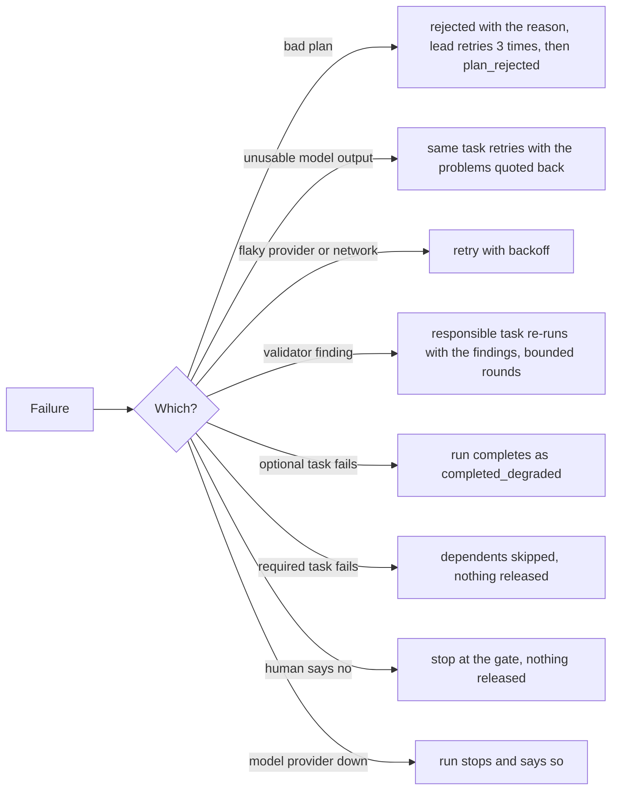
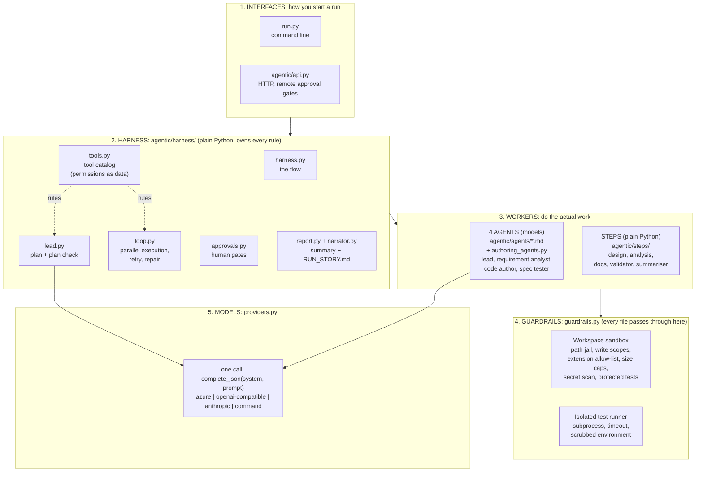

# Architecture: what was built and why

Read the [root README](../README.md) first for the problem and how to run things. This page explains the design in plain language. Each use case then has its own page in [usecases/](usecases/).

## 1. What this is

A system that takes a **software requirement** and returns a **reviewable engineering result**: a plan, code, an API contract, tests, documentation and a summary. It is not a chatbot.
Four models do the creative work (planning, writing code, writing tests). Plain Python decides what they are allowed to do, checks what they produce, and a human approves the important moments.

**The one idea: models propose, the harness decides.**

- **Models are untrusted.** They can be wrong, flaky, or steered by the text they are given.
- **Quality is measured by running things**, never by asking a model "does this look right?": parse the code, run the tests, diff the API, drive the service, run new tests against the old code.
- **Humans own the irreversible decisions**: approve the plan before work starts, approve the validated result before anything is released.
- **Every claim has evidence in a file** (`events.jsonl`, `state.json`, `ENGINEERING_SUMMARY.md`).

| Term | Meaning |
|---|---|
| **Agent** | a model with a role, limits and a prompt, written as a Markdown file in `agentic/agents/`. There are four |
| **Step** | a deterministic Python unit (`agentic/steps/`): design, analysis, docs, validation. No model call, so it is reproducible and unit-tested |
| **Harness** | the Python that owns everything with consequences: plan checking, permissions, the sandbox, retries, validation, the human gates, release |
| **Blackboard** | the shared record of facts (`contract`, `schema`, `code`, `tests`...) that tasks publish and read. Workers never call each other |
| **Gate** | a point where a human must approve: the plan, an amended existing test, the release |

## 2. A run, start to finish

```mermaid
flowchart LR
  REQ["Requirement<br/>(+ existing code)"] --> DISC["1. Discover<br/>understand the request"]
  DISC --> LEAD(["2. Lead agent<br/>proposes a task plan"])
  LEAD --> CHK["3. Harness checks the plan"]
  CHK -- "rejected, with the reason" --> LEAD
  CHK --> G1{{"Human gate:<br/>approve the plan"}}
  G1 --> BUILD["4. Build<br/>agents and steps run in parallel"]
  BUILD --> VAL["5. Validator<br/>executes the checks"]
  VAL -- "findings go back to the<br/>responsible task" --> BUILD
  VAL --> G2{{"Human gate:<br/>approve the release"}}
  G2 --> OUT["6. release/ and<br/>ENGINEERING_SUMMARY.md"]
  OUT -.-> USE["7. Optional: use it<br/>(shorten your URL)"]
```

1. **Discover.** Rules read the requirement: what is being asked, is it vague? A vague request (for example "faster and more secure", no numbers) **pauses with questions and generates nothing** until a human answers. If there is existing code, an `ast` analysis finds the modules, routes, tables and impact, and the existing test suite is run before anything is touched.
2. **Plan.** The lead agent proposes tasks with dependencies, for example *design contract, then write code and write tests in parallel, then validate*.
3. **Check.** The harness rejects the plan, with the exact reason, if it breaks a rule: an unknown tool, a missing input, a cycle, two tasks writing the same file, or no validator at the end. Three rejected plans stop the run. There is no hidden offline plan: no model, no run.
4. **Build.** Ready tasks run in parallel (the lead picks which to start). Agents write only through the sandbox, into the paths their tool is allowed to touch.
5. **Validate.** The validator runs the checks (section 5). A failure names the *role* responsible (code, tests, contract) and that producer re-runs with the findings quoted back, a bounded number of times.
6. **Release.** Only after a human approves are files copied into `release/`, with an `ENGINEERING_SUMMARY.md` (plan, rationale, evidence, risks, approvals, limits).
7. **Use it (optional).** `python run.py greenfield --shorten <url>` takes the released service and shortens your URL with it (section 8).

## 3. Who does what

**Four agents (models).** Each is a Markdown file (role, responsibilities, guardrails, failure handling, system prompt) so its behaviour can be reviewed without reading code. The file *describes*; the harness *enforces*: the Markdown cannot grant a permission.

| Agent | What it does | What it cannot do |
|---|---|---|
| `project_lead` | proposes the task plan; each turn picks which ready tasks start | write files, widen a permission, approve anything |
| `requirement_analyst` | rules find vague terms and classify the request; the model may only **add** questions | remove or change a rule-based result |
| `code_author` | writes the whole service (new work) or minimal anchored edits (a change) | edit tests, write outside `shortener/*`, `openapi.json`, `schema.sql`, `changes.diff` |
| `spec_tester` | writes tests from the **specification only**, never seeing the code | read the code; edit an existing test, except one narrow human-approved case |

**Steps (plain Python, no model).** Architecture decisions, the OpenAPI contract and database schema, the risk register and test strategy, codebase analysis, documentation, the validator and the summariser. They are deliberately **not** called agents.

**Why the split.** A model is used where judgement is needed. Everything that must be reproducible, testable and trustworthy is code.

**Coordination.** Agents never call each other. Tasks publish facts to the blackboard and others wait for them. The test author waits for the API contract the code author publishes but never sees the code, so the tests are an **independent** check.

## 4. How the harness keeps models in check

| Risk | Guardrail |
|---|---|
| A bad or over-powerful plan | `check_plan` against the **tool catalog** (`harness/tools.py`), a data file that says what each tool needs, provides and may write. The model cannot edit it |
| An agent writes where it should not | per-task write scopes from the catalog, a path jail, an extension allow-list, 200 KB per file and 200 files |
| Secrets in generated code | the same pattern scan in three places: on the model's reply before writing (so it can fix it), on every write (the hard stop), and again in the validator |
| Unusable model output (bad shape, syntax error, NUL byte, secret-like text) | checked before writing; the **same task retries with the exact problems quoted back** |
| Untrusted code execution | tests run in a subprocess: hard timeout, isolated mode, environment scrubbed to a few variables |
| Damaging the customer's repo | edits happen on a workspace copy; a pristine `baseline/` is kept |
| An agent rewriting the tests that judge it | existing tests are protected (section 6) |
| Runaway loops | bounded plan attempts, lead turns, task attempts and repair rounds |
| Unreviewed release | `release/` is written only after the release gate |
| Prompt injection | the requirement is data, screened and flagged, never obeyed; model output is parsed defensively |

**Human gates** (`harness/approvals.py`): `plan_approval` (before any work), `test_update_approval` (only if an agent amended an existing test, showing every diff), `release_approval` (after validation). Modes: `interactive` (you type y/n), `auto` (approves only when nothing blocks; for CI and demos, labelled `policy:auto`, **not a review**), `reject` and `reject:<gate>`. Every decision is recorded with who made it.

## 5. What the validator checks

It executes things and never asks a model. Each finding names a role, and the harness maps the role to whichever tasks the lead's plan contains.

| Check | What it runs |
|---|---|
| `static` | `ast.parse` every `.py`, secret scan, required files |
| `probe` | a black-box behavioural probe of the public interface (create, redirect, not found, bad input, conflict, stats, delete, restart persistence), then checks the real database against the designed schema |
| `tests` | the whole test suite in an isolated subprocess |
| `regression` | the baseline stays green; the suite grows (or does not shrink); for a bug fix, **new tests must fail on the old code** |
| `compat` | OpenAPI diff: removing or breaking anything is rejected; a refactor or tests-only change must leave it **identical** |
| `traceability` | every acceptance criterion maps to a real test function |
| `scope` | a tests/docs-only change wrote no production file |

**The kind of change decides what is allowed and proved**, detected from the wording of the request:

| Kind | Tools offered | Additionally required |
|---|---|---|
| enhancement | code, tests, docs | suite grows; API additive only |
| bug fix | same | green after the fix; **new tests fail on the unfixed code** |
| refactor | code, docs | suite not smaller; API identical |
| tests / docs | tests and docs only (the code agent is not offered) | no production file written; API identical |

## 6. Keeping the tests honest

The model writes both the code and the tests, so the harness stops either from quietly weakening the other.

**A. Approved test updates.** An agent may not edit a test it did not write. One exception exists because a live enhancement run hit a real problem: a baseline test pinned the entire OpenAPI document, so any contract change broke it and no agent was allowed to touch it. The narrow exception: only `spec_tester`, only in an enhancement, only after a validation failure, only if the contract really changed, and only if a **count** shows the suite did not get weaker (no test removed, no assertion lost, nothing skipped, valid Python, at most five edits). The validator then compares every baseline test on disk with the pristine copy, and the `test_update_approval` gate shows a human each diff and reason. The count cannot judge a subtly wrong new expectation; the human gate is the backstop.

**B. Bug-fix proof.** A regression test is evidence only if it fails on the bug. The validator copies the pristine buggy code to a temporary folder, adds the new tests and runs them: at least one must fail by assertion, then all must pass on the fix. If the tests also pass on the buggy code, the check fails and blames the tests.

## 7. When something goes wrong

| Error type | The loop's response |
|---|---|
| `TransientError` | retry with exponential backoff |
| `ValidationFailure` from a producer (its own pre-check) | self-correct with the findings; counts as an attempt |
| `ValidationFailure` from the validator | repair loop: the blamed producers and their dependents re-run (3 rounds with a model) |
| `GuardrailViolation`, `FatalError` | fail now, never retried |
| any other exception | contained: that task fails, the run continues, the traceback is logged |

A hard dependency that failed means the dependent is **skipped**. `--resume` re-runs only the tasks that did not succeed. The lead is asked again after a bad decision and, after two bad answers, the harness starts all ready tasks itself and logs `lead_fallback`.

**The rule we apply:** anything a model can get wrong and fix on a second attempt must be *feedback*, not a fatal error; the guardrails stay as the hard stop behind it. Two live runs died before this rule covered everything: a reply with a NUL byte (Python below 3.12 raises `ValueError`, not `SyntaxError`, from `ast.parse`) and a test file containing `token = "abcdefgh12"` (rejected only at write time). Both are now caught before writing and fed back.

## 8. The three use cases and how a user tests them

| Use case | What happens | The user's own test | What proves it worked |
|---|---|---|---|
| **Greenfield** | build the URL shortener from a requirement | `python run.py greenfield --shorten <url>` (optionally `--alias`, or their own URL-shortener requirement via `--requirement-file`) | status `completed`; a `302` redirect back to exactly that URL; the generated tests green; the plan, validation evidence and approvals in `ENGINEERING_SUMMARY.md` |
| **Brownfield** | change the existing service: bug fix, enhancement, refactor, tests-only | plant a bug yourself in a copy (five ready-made bugs in `input/brownfield/bugs/`), then `python run.py brownfield --repo <copy> --requirement-file <bug report> --verify` | the new tests fail on the buggy copy and pass on the fix; the suite is green; `changes.diff` is small |
| **Ambiguous** | a vague request pauses with questions, then (given answers) produces a proposal, not code | `python run.py ambiguous`, then `--answers` or `--assume-defaults` | no `release/` after step 1; after step 2 a `PROPOSAL.md` with measurable objectives, options and trade-offs, and a gap analysis against the existing code |

**What `--shorten` does.** After a run that ends `completed`, the CLI hands the **released** `release/` (never the workspace) to `scripts/shorten_url.py`. It starts the service from a temporary copy on `127.0.0.1` with a throwaway database, shortens your URL through the public API, checks that the redirect equals your URL, reads the analytics and leaves the service running so the short URL opens in a browser until Ctrl+C (`--once` stops it at once). It sits outside the harness: it cannot change a verdict, and it is skipped with the reason if nothing was released. It never replaces the agents: the service exists only because they built, tested and released it in the same command.

**Brownfield, honestly.** The agents do **not** discover bugs: a person reports the symptom in plain English and the agents work out where it lives, fix it minimally, and the validator proves it. Without `--repo`, `python run.py brownfield` plants one built-in bug (`scripts/seed_bug.py`) for a no-effort run.

## 9. How the code is laid out

Five layers; each builds on the one below.

Read it top to bottom: you start a run (1); the harness decides the flow and enforces the rules (2); workers do the work (3); everything a worker writes or runs goes through the guardrails (4); only agents and the lead reach a model (5), and the harness treats whatever comes back as untrusted.

The model layer knows nothing about this project, and no agent file names a vendor (a test enforces it). The model's reply is parsed defensively, path-filtered, size-capped and syntax-checked, and every file goes through the sandbox. `python scripts/model_smoke.py` checks the connection first.

`agentic/api.py` and `infra/` deploy the harness to Azure Container Apps with remote approval gates (see [AZURE_DEPLOYMENT.md](AZURE_DEPLOYMENT.md)); this has not been tried in Azure.

## 10. Key decisions and why

| Decision | Why | Cost |
|---|---|---|
| The model plans; the harness checks the plan | real decomposition without trusting a model with permissions | a bad plan costs a retry; runs are not reproducible end to end |
| Rules live in a data catalog | a reviewer can read what each tool may do; a prompt cannot override it | the catalog must stay in step with the steps (a test enforces it) |
| Tests come from the spec, never from the code | an independent oracle: the author cannot grade its own work | needs a good contract |
| Deterministic steps around the models | design, validation and the sandbox stay testable | an offline reference generator exists, for the test suite only |
| Human gates, no auto-release | the irreversible steps stay with a person | slower than full automation |
| Existing tests protected, one counted and human-approved exception | an author must not edit its own judge, yet a contract change can make a test obsolete | a count cannot judge a subtly wrong expectation; the human gate does |
| Everything bounded (plan tries, lead turns, attempts, repairs) | the loop always ends and cost is capped | a hard case ends as `failed`, not "keep trying" |

## 11. Assignment requirements: where each is met

| Requirement | Where to see it |
|---|---|
| Interpret intent, find ambiguity, restate as an engineering problem | `steps/analysis.py` (`RequirementAnalyst`); `output/*/ENGINEERING_SUMMARY.md` section 1; the ambiguous use case |
| Decompose into tasks with dependencies and an order | `harness/lead.py`, `harness/tools.py`; `plan.json` and the wave table in the summary |
| Reason about existing code | `steps/analysis.py` (`CodebaseAnalyst`); summary section 2 of any brownfield run |
| Orchestration: parallelism, coordination, error handling and recovery | `harness/loop.py`; retries, repair rounds and `--inject` fault injection (tests in `tests/test_e2e.py`, `tests/test_loop.py`) |
| Code, API contracts, tests, docs | `output/greenfield/release/` |
| Risks, trade-offs, validation strategy, guardrails | `release/docs/RISKS.md` and `ADR.md`; summary sections 6 and 7; `harness/guardrails.py` |
| Controlled autonomy | three human gates, interactive mode, `reject:<gate>`, the approval audit in the summary |
| A final structured engineering summary | `harness/report.py` and `ENGINEERING_SUMMARY.md` in every run |

Controlled autonomy in one line: agents run freely and in parallel between gates; they cannot approve anything, widen a permission, edit the tests that judge them, or release.

## 12. Limits and roadmap (say these before anyone asks)

1. **Not reproducible end to end.** Models write the plan, the code and the tests, so two runs can differ and need a different number of repairs. Mitigation: `plan.json` is recorded.
2. **Only one provider has run live**: Azure. `openai`, `anthropic` and `command` are tested for wire format with mocked HTTP only.
3. **The Azure Container Apps deployment has not been tried.**
4. **A run can still fail.** If the model's output is rejected after the bounded retries, the status is `failed` and nothing is released. Re-running often passes.
5. **The validator proves "consistent and tested", not "right for the business".**
6. **Static analysis is heuristic** (decorator routes and SQL string literals only), and **ambiguity detection is lexical**.
7. **Subprocess isolation is not a container**: a hostile generated test could still use the network or disk.
8. **The generated service is a prototype**: SQLite single writer, an in-process cache, a per-node rate limiter.
9. **The amendment check counts; it does not understand.** The human gate is the backstop.
10. **`auto` approval is a policy, not a reviewer.**
11. **A `--shorten` short URL is ephemeral.** It runs from a temporary copy on `127.0.0.1` with a throwaway database, so it works only while that process runs. Every `--shorten` run rebuilds the service (about 9 minutes).
12. Documentation changes produce a change record, not rewritten prose.

**Roadmap:** an eval harness (golden requirements, first-pass rate, cost per run); a container sandbox with no network or identity; a durable workflow engine for long-lived approvals; a documentation-writing agent; plan replay and model pinning.
