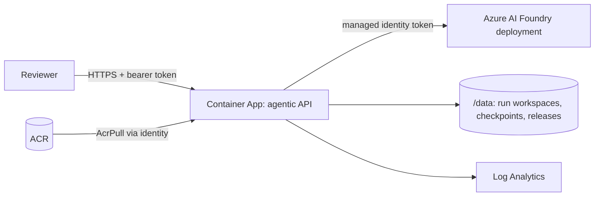

# Optional: deploying to Azure Container Apps

This document is only for running the harness as a **hosted HTTP service** with remote human approval. To run the scenarios on your own machine you do not need any of
it: see [HOW_TO_RUN_AND_VERIFY.md](HOW_TO_RUN_AND_VERIFY.md) and [MODEL_SETUP.md](MODEL_SETUP.md).

What the deployment adds:

- `agentic/api.py` exposes the harness as an authenticated HTTP service. The human gates (`plan_approval`, `test_update_approval` when needed, `release_approval`) are decided
  **remotely by a person** with a recorded identity.
- It deploys to **Azure Container Apps** with a **managed identity**, so no model key is stored anywhere.

> **Status, stated plainly.** The local scenarios have been run against a real Azure AI Foundry deployment. **The Azure deployment itself has not been tried**: the API,
> the remote gates and the client script are tested only against a local server, the Dockerfile has not been built (no Docker daemon was available) and the Bicep has not
> been compiled. `deploy.ps1` runs `az bicep build` first, so a Bicep syntax problem fails before anything is created. Treat this as a documented, untested path.

---

## 1. What you need

| Item | Notes |
|---|---|
| An **Azure AI Foundry** (or Azure OpenAI) resource with a **chat model deployment** | note the **deployment name** (Foundry, Deployments) and the **endpoint** (`https://<resource>.openai.azure.com` or `.services.ai.azure.com`) |
| Azure CLI (`az`), logged in | `az login`; Contributor on the target resource group, and permission to create a role assignment on the Foundry resource (Owner or User Access Administrator) |
| Quota | a greenfield run is roughly 10 model calls and 100 to 150k tokens including repair rounds. A very low tokens-per-minute quota slows runs down (429s are retried with backoff) |
| A strong model | the code call asks for up to 24k output tokens and the lead must return a valid JSON plan |

## 2. Step 1: prove the model connection locally

Put the settings in `.env` (see [MODEL_SETUP.md](MODEL_SETUP.md)) or in the environment, then:

```powershell
python scripts/model_smoke.py
```

| Symptom | Meaning |
|---|---|
| `HTTP 401` | wrong key or wrong resource |
| `HTTP 403` | with Entra auth: missing role **Cognitive Services OpenAI User** on the resource (can take minutes to propagate); with a key: firewall or network rules |
| `HTTP 404` | `AZURE_AI_DEPLOYMENT` is not the *deployment name*, or the endpoint includes a path |
| `HTTP 429` or truncated | quota or output limit; retry, or raise the deployment quota |

## 3. Step 2: run the scenarios locally first

```powershell
python run.py greenfield
python run.py brownfield
python run.py enhancement
python run.py ambiguous
python scripts/verify_outputs.py
```

The model is the default generator; there is no separate "LLM mode" flag to set. See [usecases/](usecases/) for what each does and how it is judged.

## 4. Step 3: deploy to Azure

```powershell
az login
./infra/deploy.ps1 -ResourceGroup rg-agentic `
    -FoundryResource <foundry resource name> `
    -FoundryEndpoint https://<resource>.openai.azure.com `
    -FoundryDeployment <deployment name> `
    [-FoundryResourceGroup <rg of the foundry resource, if different>] [-Location eastus2]
```

What it does, in order: validates the Bicep (`az bicep build`) -> creates the resource group -> deploys **Log Analytics,
ACR, a Container Apps environment and the app** (system-assigned managed identity) plus two role assignments (AcrPull on
the registry; **Cognitive Services OpenAI User on the Foundry resource**) -> builds the image **in ACR** (no local Docker
needed) -> switches the app to the image -> waits for `/healthz` -> prints the URL and a **generated API token (shown
once)**.



Why these choices:

- **Managed identity, no model key.** The app obtains an Entra token for `https://cognitiveservices.azure.com` from the
  Container Apps identity endpoint. `AZURE_AI_API_KEY` is supported for local use but is not set in Azure.
- **One replica** (`min = max = 1`). Run state and *pending approval gates live in process memory*; two replicas would
  split a run's gates across processes. The path to scale is a durable workflow engine (Temporal/Durable Functions) and a
  shared store; see Limitations.
- **Gates are decided over HTTP.** A run blocks at `plan_approval`, `test_update_approval` (only if an agent amended an existing test) and `release_approval` until someone `POST`s a
  decision (with `by`, recorded in the audit trail). **An unattended gate times out as REJECTED** (default 1 h): an idle
  run can never ship by itself. `approval=auto` is disabled on the server unless `AGENTIC_ALLOW_AUTO=1`.
- **Remote callers cannot name filesystem paths.** A brownfield target is another *run id*, and only a run that completed
  and was approved has a releasable codebase.

## 5. Step 4: test the deployed service end to end

```powershell
python scripts/cloud_e2e.py --url https://<app>.<region>.azurecontainerapps.io --token <api token>
```

It submits the mandatory requirement, waits for the **plan gate**, shows you the plan, asks you to approve, lets the
agents run, shows the **validation evidence and LLM usage** at the **release gate**, asks again, then downloads
`release.zip` and `ENGINEERING_SUMMARY.md` into `cloud_out/<run_id>/`. Then verify the artifact yourself:

```powershell
cd cloud_out/<run_id>/release
python -m unittest discover -s tests -t .
python -m shortener.server --port 8080
```

Useful: `--yes --by ci-bot` for unattended approvals in CI, `--generator template` to compare with the deterministic path.

### API reference

| Call | Purpose |
|---|---|
| `GET /healthz` | liveness + which provider/deployment the server is wired to (no auth) |
| `POST /runs` `{requirement, generator?, target_run?, answers?, assume_defaults?}` | start; `generator` defaults to `llm` when configured |
| `GET /runs/{id}` | status, `pending_gate` (summary + evidence), task states, validation, LLM usage, decisions |
| `POST /runs/{id}/gates/{plan_approval\|test_update_approval\|release_approval}` `{approved, by, note?}` | the human decision |
| `POST /runs/{id}/answers` `{answers}` | answer clarification questions (starts a continuing run) |
| `GET /runs/{id}/summary` \| `/events` \| `/files[/path]` \| `/release.zip` | engineering summary, audit log, released artifacts |

## 6. Operating it

```powershell
az containerapp logs show -g rg-agentic -n agentic-api --follow          # live logs
az containerapp show -g rg-agentic -n agentic-api --query properties.configuration.ingress.fqdn -o tsv
az group delete -n rg-agentic --yes                                     # tear everything down
```

Environment variables (set by Bicep): `AZURE_AI_ENDPOINT`, `AZURE_AI_DEPLOYMENT`, `AGENTIC_API_TOKEN` (secret),
`AGENTIC_DATA_DIR=/data`, `AGENTIC_GATE_TIMEOUT`, `PORT`. Optional: `AGENTIC_MAX_ACTIVE_RUNS` (default 2),
`AGENTIC_ALLOW_AUTO`, `AZURE_AI_API_KEY`, `AZURE_CLIENT_ID` (for a user-assigned identity).

Cost shape: Container Apps (1 vCPU / 2 GiB, always on) + ACR Basic + Log Analytics + **model tokens per run** (usage is
recorded in the summary and in `GET /runs/{id}`).

## 7. Limitations of this deployment (and what I would do next)

1. **The deployment has not been exercised in Azure** (see the status note); the local runs against Foundry have. The offline tests prove
   the wire format, the error taxonomy and the system's handling of good/bad model output; they cannot prove the quality
   of a specific model's code. Expect to see **repair rounds** on real runs; that is the system working.
2. **State is in memory and on the container's disk** (`/data` is ephemeral). A restart marks in-flight runs
   `interrupted` and loses pending gates. Next: Azure Files or Blob for `/data`, a database for run state, and Temporal /
   Durable Functions so an approval can wait days.
3. **Single replica** by design (above).
4. **Token delivery.** The API token is passed to `az deployment` as a secure parameter (visible briefly in the local process
   list). Production: Key Vault reference + Entra ID auth on the API (Container Apps built-in auth) instead of a shared token.
5. **Code execution isolation.** Generated tests run in a scrubbed subprocess inside the container. For untrusted prompts
   use a separate sandbox (Container Apps jobs / dynamic sessions) with no network and no managed identity attached,
   because the validator subprocess shares the container.
6. **Public ingress.** Put the app behind Entra auth / private endpoints / IP restrictions for anything beyond a demo.
7. **Dockerfile and Bicep untested here** (no Docker daemon, no Azure CLI): `az bicep build` and `az acr build` surface
   problems early and cheaply.
