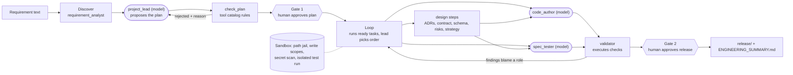

# Use case 1: Greenfield. "Build a scalable URL shortener service with APIs, persistence, and analytics."

**Read this first if you are new.** It explains what happens, who does what, how the result is judged, and why each choice was made. The shared
vocabulary is in [../ARCHITECTURE.md](../ARCHITECTURE.md); how to run and check it (including shortening your own URL) is in the [root README](../../README.md#5-prerequisites-and-quick-start); advanced runs and demos are in [../HOW_TO_RUN_AND_VERIFY.md](../HOW_TO_RUN_AND_VERIFY.md).

| | |
|---|---|
| **Input** | one sentence of requirement, no existing code |
| **Command** | `python run.py greenfield` (about 9 minutes, about 10 model calls). To test it on **your own URL**: `python run.py greenfield --shorten <url>`: the agents build the service, then the service they built shortens your URL (optionally `--alias`, or your own URL-shortener requirement via `--requirement-file`) |
| **Output** | `output/greenfield/` (open `RUN_STORY.md`, then `DEMO_RESULT.md`, which shows a real long URL shortened by the generated service): `ENGINEERING_SUMMARY.md` (the deliverable), `plan.json`, `events.jsonl`, and `release/` (the service) |
| **Goal** | show requirement understanding, decomposition, multi-step orchestration, generated code, API contract, tests, and a validation strategy, under human oversight |

## 1. What takes part

Two kinds of worker. **Agents** are models with a role (`agentic/agents/*.md`). **Steps** are deterministic Python. The **harness** runs and polices both.

| Worker | Kind | Job in this use case |
|---|---|---|
| `requirement_analyst` | agent (model may only add questions) | normalise the requirement, find vague terms, record assumptions |
| `project_lead` | agent (model) | propose the task plan and, each turn, choose which ready tasks start |
| `architect`, `contract_designer`, `data_modeler` | steps | architecture decisions (ADRs), the OpenAPI contract, the SQL schema |
| `risk_assessor`, `validation_strategist` | steps | risk register, then a test strategy derived from the risks |
| `code_author` | agent (model) | write the whole service from the contract and schema |
| `spec_tester` | agent (model) | write the test suite from the specification only, never seeing the code |
| `doc_writer` | step (optional) | README, architecture, ADR, risks, testing docs |
| `validator` | step | execute every check; blame a role for each failure |
| `summarizer` | step | collect the evidence for the engineering summary |



## 2. Design flow, step by step

1. **Discover.** The analyst screens the text (length cap, control characters, injection patterns are flagged and treated as data), recognises the domain
   (`url_shortener`), and produces 6 capabilities, 3 assumed non-functional requirements, 9 acceptance criteria and one documented assumption for the vague word
   "scalable" (10M links a month, about 4k redirects a second at peak, medium confidence, flagged "needs confirmation"). One vague word in a known domain does **not** block;
   it becomes an assumption a human can overrule.
2. **Plan.** The lead proposes tasks over the tool catalog. `check_plan` verifies every tool exists, every fact a tool needs is provided by a task it depends on, there is no cycle,
   no two concurrent tasks can write the same file, and exactly one validator waits for everything. A bad plan returns to the lead with the exact reason (3 tries).
   A real plan from `output/greenfield/plan.json`:

   | Wave | Tasks | Why this order |
   |---|---|---|
   | 1 | `design_architecture` | every later decision depends on the storage port, async analytics and cache choices |
   | 2 | `design_contract`, `design_schema` | independent of each other, so they run in parallel |
   | 3 | `assess_risks`, `implement_service` | the code author needs only the contract and schema, so it starts without waiting for risks |
   | 4 | `plan_validation` | the test strategy is derived from the risks **before** any test exists |
   | 5 | `write_spec_tests`, `write_documentation` (optional) | tests come from the contract and strategy, never from the code |
   | 6 | `validate_service` | repair targets: the code and the tests |
   | 7 | `summarize_results` | |

3. **Gate 1: a human approves the plan** (`--approve interactive`) before anything is generated. `auto` approves when there are no blocking issues and is labelled `policy:auto`.
4. **Loop.** Design steps publish facts on the **blackboard** (`design`, `contract`, `schema`, `risks`, `validation_strategy`). `code_author` receives the contract, schema, ADRs and an interface spec
   (`create_app(...)`, `flush_analytics()`, `close()`, `server.main()`), and returns a whole service. In a **separate call** `spec_tester` receives the spec, the acceptance criteria and a provided
   test client, and writes tests. Every file goes through the sandbox: path jail, write scope, extension allow-list, size caps, secret scan.
5. **Validate** (section 4). Failures name a **role** (`code`, `tests`); the harness maps the role to the lead's tasks, re-runs them with the findings as feedback, up to 3 rounds.
6. **Gate 2: a human approves the release.** Only then is `release/` written. The summary is rendered last, so it includes the approval audit.

## 3. The product that gets generated

```
CREATE    client -> [API key?] -> [token bucket per client] -> validate URL -> random 7-char base62 code
                 -> INSERT (UNIQUE) -> on collision retry (bounded) -> 201 + Location
REDIRECT  client -> cache.get(code) -> hit: done | miss: repo.get_link -> cache.put
                 -> recorder.record(event) [non-blocking] -> 302 Location
ANALYTICS recorder queue (bounded) -> flusher thread -> ONE transaction per batch
                 -> INSERT click_events + UPSERT click_daily -> /stats aggregates
```

API (`openapi.json`): `POST /api/v1/links`, `GET|DELETE /api/v1/links/{code}`, `GET /api/v1/links/{code}/stats?days=` (1 to 90), `GET /{code}` (302 or 404), `GET /healthz`, `GET /openapi.json`.
Tables: `links` (soft delete keeps a code reserved), `click_events` (salted-hash visitor, no raw IP), `click_daily` (rollup).

## 4. Test cases: how the output is judged

The model's code structure is not ours, so judgement is **black-box and executed**. The validator ran 9 checks on the committed run; all passed.

| Check | What it executes | On failure blames |
|---|---|---|
| `static.syntax` | `ast.parse` of every Python file | code |
| `static.secrets` | pattern scan (AWS keys, private keys, `password = "..."`) | code |
| `static.required_files` | `openapi.json`, `schema.sql`, `shortener/app.py`, `shortener/server.py` exist | code |
| `probe.behaviour` | **14 black-box probes** through the public WSGI interface (below) | code |
| `probe.schema_conformance` | every designed table and column exists in the database the code actually created | code |
| `tests.suite` | the model-written suite, in an isolated subprocess (hard timeout, scrubbed environment) | code, then both after round 1 |
| `traceability.acceptance_criteria` | every acceptance criterion maps to a real test named `test_ac<N>_...` (found by AST) | tests |
| `traceability.risks` | risks that name a covering test resolve to real tests (none are named for model-written suites, so this passes trivially) | tests |
| `docs.present` | README, architecture, ADR (a **warning**: documentation is optional) | none (degrades) |

The 14 probes: create returns 201 with `code` and `short_url`; redirect is 302 with the original `Location`; unknown code is 404 with an error body; non-http scheme is 400; loopback destination is 400;
custom alias 201 then conflict 409; invalid alias 400; metadata 200; stats 200 with numeric `total_clicks`; stats `days` out of range 400; `healthz` 200; delete 204 then 404; `X-Request-Id` header present;
links survive a restart on the same database file.

**The generated suite (73 tests in the committed run)** was written by a call that never saw the code: `test_links.py` (19), `test_validation.py` (21), `test_analytics_persistence.py` (16), `test_auth_rate_limit.py` (12), `test_contract.py` (5),
plus a provided `wsgi_client.py` helper. They cover creation, alias rules, redirects, deletion, stats and uniqueness, URL validation (hostile hosts, CRLF, bad schemes), analytics batching, drop-not-block and persistence, API keys and rate limiting,
and that the router equals the OpenAPI document. File names and counts differ from run to run because the model writes the suite.

**Framework tests for this path** (offline, scripted model): the happy path produces a validated release with 2+ concurrent tasks; an injected defect is caught and repaired through feedback; transient failures
are retried with backoff; an optional task failing degrades instead of blocking; a fatal failure skips dependents and releases nothing; resume re-runs only what failed; a human veto at either gate releases nothing;
injection text in the requirement is flagged and not obeyed; and the released service really starts as a subprocess and answers requests (`tests/test_e2e.py`, `tests/test_harness.py`).

**Check it yourself:** `python scripts/verify_outputs.py greenfield`, or run `python run.py greenfield --shorten <your url>` and open the short URL it prints (README, "Test greenfield on any URL").

## 5. Decisions and why

| Decision | Why | Trade-off |
|---|---|---|
| Contract first (OpenAPI and schema before any code) | parallel workers share one source of truth; drift becomes a visible disagreement | the contract itself can be wrong; the probe and tests expose that |
| The test author never sees the code and runs in a separate call | an independent oracle: tests cannot just assert whatever the code does | needs a precise contract; both sides may be wrong, so after round 1 both are blamed |
| Black-box validation (probe plus database inspection) | the model decides the code structure, so only behaviour can be judged | does not prove internal quality |
| Strategy derived from risks before tests | tests are risk-driven, not a checklist | more steps before code |
| Documentation is optional (`completed_degraded`) | a missing README must not block a working service | a release can ship with thin docs, shown as a warning |
| Random base62 code, 7 characters, UNIQUE plus bounded retry (ADR-001) | no coordination between nodes, non-enumerable, collision odds about 0.03% at a billion links | needs a unique index and a retry path; counters are enumerable, hashes leak URL equality |
| Repository port with SQLite (WAL) now, PostgreSQL or DynamoDB later (ADR-002) | access is pure key-value; scale-out is an adapter swap | SQLite is single-writer and single-node: a prototype, not the stated scale |
| 302 by default (ADR-003) | a 301 is cached by browsers, so clicks bypass us and analytics under-count | more traffic, no CDN offload |
| Bounded queue and batch flusher for analytics (ADR-004) | redirect latency must not depend on the analytics store | clicks can be lost on a crash or dropped when full (counted); stats are eventually consistent |
| In-process TTL+LRU cache (ADR-005) | traffic is Zipfian | a deleted link can be served up to the TTL on other nodes |
| Salted SHA-256 visitor hash, raw IP never stored (ADR-006) | unique visitors without personal data | an approximation (NAT, user-agent changes) |
| Stateless nodes, per-node token bucket (ADR-007) | any node serves any request | the effective limit is limit times nodes until a shared limiter exists |
| Up to 3 repair rounds, then fail | bounded cost; a systematic problem is escalated, not hidden | a hard case ends `failed` |

## 6. Real problems this use case surfaced (and the fixes)

A model returned a file with a syntax error and self-corrected on the next attempt; the first suite run was red and one repair round made it green; the test author was once told to use a clock helper that did
not exist, so it now sees only helpers the codebase really has; tests once ran before the contract existed, so the test author now waits for it; wrong blame meant a real code bug could not be sent back, so a failing
new test now blames both sides.

## 7. Limits

Not reproducible end to end (the model writes the plan, code and tests; the committed output is one run), and a run can still end `failed` if the model's output is rejected after the bounded retries. SQLite and the in-process cache and limiter are single-node.
Capacity numbers are assumptions. The validator proves "consistent and tested", not "right for the business". The general limits are in [../ARCHITECTURE.md](../ARCHITECTURE.md), section 12.
