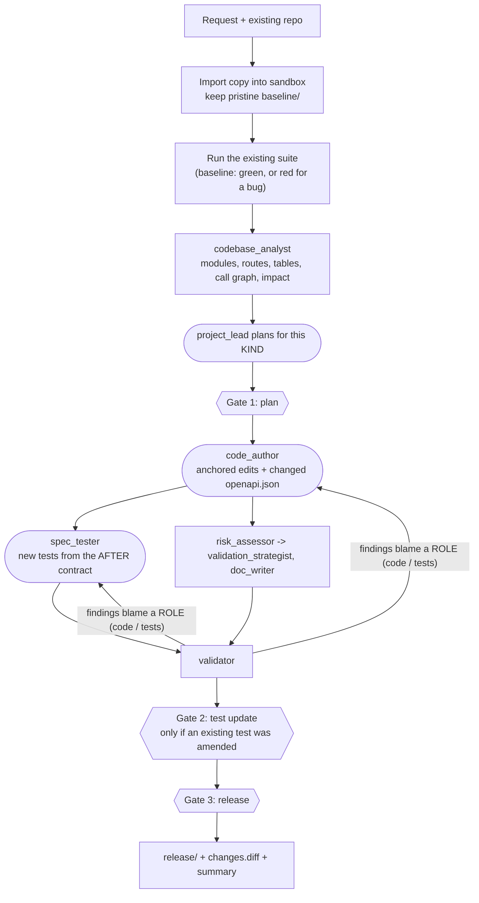

# Use case 2: Brownfield. Changing code that already exists

**Read this first if you are new.** Shared vocabulary is in [../ARCHITECTURE.md](../ARCHITECTURE.md); run and check commands are in
[../HOW_TO_RUN_AND_VERIFY.md](../HOW_TO_RUN_AND_VERIFY.md). Greenfield is [01_GREENFIELD.md](01_GREENFIELD.md).

## Input and output of this use case

| | Where | What |
|---|---|---|
| **Input 1: the request** | `input/brownfield/requirement.txt` (also `input/enhancement/`, `input/refactor/`, `input/tests_improvement/`) | the change a person asks for, in plain English |
| **Input 2: the existing code** | a **copy** of `output/greenfield/release` (for the bug fix, with one bug planted: `output/brownfield/input/existing_code_with_bug/`) | the software to change. It is generated by the greenfield run, so there is no copy in the top-level `input/` folder |
| **Output** | `output/brownfield/` | `RUN_STORY.md`, `ENGINEERING_SUMMARY.md`, `release/` (with `changes.diff`), `plan.json`, `events.jsonl`, and `input/` (a copy of exactly what this run was given) |

See [../../input/README.md](../../input/README.md).

## 0. How this fits the URL shortener (read this first)

Greenfield (use case 1) **built** the URL shortener. Brownfield is the next chapter of the same story: **the shortener now exists and is in use, and a person asks for a change.**
It might be a defect they noticed, a new feature, a tidy-up, or missing tests. The system's job is to change *existing* code safely, which is harder than writing new code, because the
change must not break anything that already works.

**A person reports the problem; the agents do not discover it.** The agents never go looking for bugs. In the bug-fix demo:

| Who | Does what |
|---|---|
| **The demo script** | copies the shortener and **plants one realistic bug** in the copy (the stats query counts every click as a unique visitor), so there is a real defect to fix |
| **You (the person)** | report it in plain English: *"Fix the bug where link stats report unique_visitors equal to the total number of clicks."* That sentence is the requirement |
| **The agents** | work out **where** in the existing code that behaviour lives (route, call chain, table: the "codebase reasoning"), make the smallest change that fixes it, and write tests |
| **The validator** | proves it: the old tests were red, they are green now, and the **new tests fail on the buggy code** (so they really catch this bug) |
| **A human** | approves the plan and the release |

So "brownfield" is not "the agent finds a bug and fixes it". It is "a person describes a change to existing software, and the agents carry it out safely and prove it".
The change types below are the same idea with different proof.

## Start with the bug fix; treat the rest as advanced

| Kind | Level | Example request | Command | Output folder |
|---|---|---|---|---|
| **bug fix** | **Your first brownfield test** | "Fix the bug where link stats report `unique_visitors` equal to the total number of clicks" | `python run.py brownfield --verify` (plants the bug, fixes it, verifies: one command) | `output/brownfield/` |
| **enhancement** (changes the API) | *Advanced. Can fail.* | "Add support for expiring short links ... return 410 Gone" | `python run.py enhancement` | `output/enhancement/` |
| **refactor** | *Advanced* | "Refactor the stats query code in storage into small helpers, without changing behaviour" | `python run.py refactor --verify` (input: `input/refactor/requirement.txt`) | `output/refactor/` |
| **tests / docs** | *Advanced* | "Improve test coverage for link deletion and alias validation" | `python run.py tests --verify` (input: `input/tests_improvement/requirement.txt`) | `output/tests_improvement/` |

**Why the enhancement can fail, and what that means.** It is the hardest kind: it changes the public contract, so an existing test may become obsolete and a model has to write code
and tests that agree on new behaviour. On live runs it passed once and failed once. A failure means the bounded repair rounds ran out before the code and tests agreed, and **nothing was
released**: the safety net worked, the change is simply not ready. Read the last `validation_check ... FAIL` line in `events.jsonl` to see why; re-running often passes.

"Brownfield" is not one scenario. The system detects the **kind** of change from the request, and the kind decides which tools the lead may use and what the validator
demands. All four kinds share the same discovery, sandbox and gates.

The target is a **copy** of the generated service (`output/greenfield/release`). The original is never modified.

## 1. What takes part

| Worker | Kind | Job here |
|---|---|---|
| `requirement_analyst` | agent | classify the request, detect the change kind, acceptance criteria |
| `codebase_analyst` | step | AST model of the existing code and the impact of the change |
| `project_lead` | agent (model) | plan the tasks for this kind of change; pick order each turn |
| `code_author` | agent (model) | propose **anchored edits** (a `find` text that must match exactly once) plus any new module, and publish the changed `openapi.json` |
| `spec_tester` | agent (model) | write new tests from the **after** contract; for an enhancement, may propose an amendment to an obsolete existing test |
| `risk_assessor`, `validation_strategist`, `doc_writer` | steps | risks, test strategy, change record (`docs/CHANGE.md`) |
| `validator` | step | executes the checks, including the test-integrity policies |

## 2. Design flow, step by step

1. **Import and baseline.** The repo is copied into the sandbox and again into a pristine `baseline/`. The existing suite is run **before anything is touched** and recorded (73 tests with the committed greenfield release, green; for the bug scenario, red).
2. **Codebase reasoning.** An `ast` model lists modules, classes, the import graph, routes, SQL tables read and written, and a receiver-aware call graph. From each route handler it follows the call chain to the
   tables it touches. Impact has two tiers: modules that must change, and modules on the flow that are re-tested but not edited, plus the tests that exercise them. If the analysis finds nothing (the generated service
   routes without decorators), it says so and the code author is shown every module that fits instead: static analysis is a hint, never a gate.
3. **Plan for the kind.** The catalog decides what the lead may use. Real plans:

   | Bug fix (`output/brownfield/plan.json`) | Enhancement (`output/enhancement/plan.json`) |
   |---|---|
   | `fix_visitor_count` (code_author) | `implement_ttl` (code_author) |
   | `assess_risks`, `plan_validation` | `assess_risks`, `plan_validation` |
   | `write_regression_tests` (spec_tester, after `plan_validation`) | `write_spec_tests` (spec_tester, after `plan_validation`) |
   | `document_fix` | `document_change` |
   | `validate_change`, `summarize_evidence` | `validate_change`, `summarize_evidence` |

   A `tests_docs` change **cannot even be planned with `code_author`**: the catalog hides it.
4. **Edit.** `code_author` returns minimal anchored edits. Each `find` must match the **pristine baseline** exactly once; zero or several matches is rejected with feedback, never guessed. Editing from the baseline
   (not from its own last output) makes a repair re-run idempotent. The result is parsed, syntax-checked and written to `changes.diff`.
5. **Test.** `spec_tester` waits for the contract the code author publishes (never its code) and writes `tests/test_change_*.py`. A bug fix gets regression tests; an enhancement gets tests for the new behaviour, boundaries,
   invalid input and backward compatibility.
6. **Validate** (section 4). A failure names a role; the harness re-runs the blamed producers with the evidence, up to 3 rounds.
7. **Gates.** Plan gate; a **test-update gate** only if an existing test was amended; release gate.

### The enhancement path, with the amendment policy

```mermaid
sequenceDiagram
  participant CA as code_author
  participant ST as spec_tester
  participant V as validator
  participant H as human
  CA->>V: edits + changed openapi.json
  ST->>V: new test_change_* tests
  V-->>CA: round 1: a baseline test (pinning the whole contract) FAILS
  V-->>ST: contract changed, so tests are blamed too
  ST->>V: new tests + test_updates (path, find, replace, reason)
  Note over V: count check: no test removed, no assertion lost, nothing skipped<br/>disk check: only recorded amendments differ from baseline
  V->>H: test_update_approval: shows every diff and reason
  H-->>V: approve (reject = nothing released)
  V->>H: release_approval
```

## 3. The two policies that keep the tests honest

The model writes both the code and the tests, so neither may quietly weaken the other.

**Approved test updates.** An agent never edits a test it did not write, except: an **enhancement**, whose OpenAPI contract really changed, where **only `spec_tester`**, **only after a validation failure** showed an existing test failing,
may propose an anchored edit with a reason. It is accepted only if a count check passes (no test removed, no assertion lost, nothing skipped, valid Python, at most five edits), through the one door
`Workspace.write_test_update` (an existing baseline `tests/test_*.py` only). The validator then compares **every baseline test on disk to the pristine copy** (`tests.existing_tests_protected`), so writing around the API still fails,
and a human sees each diff at the `test_update_approval` gate.
*Honest limit:* the check counts, it does not understand. A live amendment kept the assertion count but made the contract comparison ignore `description` and `summary`; only the human gate catches that. Read the diff.

**Bug-fix proof.** A regression test only counts if it fails on the bug. The validator copies the baseline to a temporary folder, adds the new tests, and runs them: at least one must fail **by assertion** (an import error does not count),
then all must pass on the fix (`regression.fails_on_old_code`). Live: 10 new tests failed on the buggy code and passed on the fix.

## 4. Test cases: what is checked, per kind

| Check | bug fix | enhancement | refactor | tests / docs |
|---|---|---|---|---|
| `static.syntax`, `static.secrets` | yes | yes | yes | yes |
| `probe.behaviour` (14 black-box probes, where the code exposes `create_app`) | warning (a fix may change probed behaviour) | warning | **blocks** | **blocks** |
| `tests.suite` (whole suite green) | yes | yes | yes | yes |
| `regression.baseline_green` (was green, still green) | no: `regression.suite_green_after_fix` instead (the baseline may start red) | yes | yes | yes |
| `regression.new_tests_added` (suite grew) | yes | yes | no: `regression.suite_not_smaller` | no: `regression.suite_not_smaller` |
| `regression.fails_on_old_code` | **yes** | no | no | no |
| `compat.openapi_additive_only` (nothing removed, no type change, no new required request field) | yes | yes | no: `compat.openapi_unchanged` (identical) | no: `compat.openapi_unchanged` |
| `tests.existing_tests_protected` | no existing test may change | only an approved amendment | no existing test may change | no existing test may change |
| `scope.tests_docs_only` (no production file written) | no | no | no | **yes** |
| `docs.present` (warning) | yes | yes | yes | yes |

Earlier live runs (against an earlier greenfield release whose suite had 69 tests; those output folders were since replaced): bug fix, 11 checks, all passed (69 to 78 tests, red baseline, 10 tests failing on the old code). Enhancement, 10 checks, all passed (69 to 86 tests, 3 additive API changes, `tests/test_contract.py` amended and approved).

**Framework tests for this path** (offline, scripted model; `tests/test_test_policy.py`, 26 tests, plus `tests/test_harness.py`): only an existing baseline test module can be replaced; tampering is detected from disk, even if written around the API,
and deleting a protected test counts; amendments may not remove, weaken or skip; only the test author in an enhancement may amend; the validator accepts an amendment only with a real contract change, a recorded reason and no weakening;
rejecting the gate blocks the release; with no amendment path the obsolete test makes the run fail; a regression test that passes on the old code, or cannot load on it, is refused; a really seeded bug is fixed end to end;
the original repository is never modified; anchor drift fails safe and is never retried.

**Check it yourself:** `python scripts/verify_outputs.py brownfield enhancement`; for the bug fix, `cd output/brownfield/input/existing_code_with_bug` and run the tests (red), then `cd ../../release` (green). Or simply run `python run.py brownfield --verify`.

## 5. Decisions and why

| Decision | Why | Trade-off |
|---|---|---|
| The change **kind** decides tools and proof | a refactor must not change the API; a tests-only change must not touch production code; "one validator for all" would allow both | one more concept; the kind is detected from wording and can be wrong |
| Anchored edits, not regenerated files | a minimal, reviewable diff; a mismatch is an error, not a guess | an edit can fail to anchor and cost a repair round |
| Always edit from the pristine baseline | a repair re-run must not build on its own previous output | a little more bookkeeping |
| Original repository never modified; edits happen on a copy | a failed run cannot damage the customer's code | disk copy |
| Baseline suite run before any change | a recorded regression reference | a red baseline is possible (bug fix handles it explicitly) |
| Validator blames roles, not task ids | the lead chooses the ids | the role-to-task mapping lives in the catalog |
| A failing **new** test blames both code and tests | either side may be wrong; the published contract arbitrates | both re-run in the same round, so they can move in different directions |
| The test author waits for the published contract, never sees the code | an independent oracle that still knows new field names and bounds | the tests start later |
| Tests may assert only on what the contract states | a live run failed three rounds on tests pinning an exact error message and description that the contract never fixed | less detail in the tests |
| Existing tests protected; narrow, counted, human-approved exception | an author must not edit its own judge, yet a contract change can make a test obsolete (a baseline test pinned the whole OpenAPI document and blocked every change) | the count cannot judge what an assertion compares |
| Bug-fix tests must fail on the old code | otherwise the test proves nothing | one extra test run |
| Impact analysis is a hint, not a gate | it recognises decorator routes and SQL literals only | on other styles the code author is shown every module |
| Expiry stored as an absolute UTC `expires_at`, enforced at read time on the cached object, 410 not 404, nullable column via migration | survives restarts and caches; a client can tell "was valid" from "never existed"; legacy rows never expire; rollback is a redeploy | clock skew between nodes; no purge job (recorded as out of scope) |

## 6. Real problems this use case surfaced (and the fixes)

Seven live enhancement attempts failed before the policy, each exposing a real harness defect now fixed: a prompt naming a helper that did not exist, tests written before the contract existed, wrong blame, an impact analysis that saw 1 of 15
files, the service interface withheld from the test author, and finally a baseline test that pinned the whole contract. After the policy, attempt 1 failed (the new tests pinned wording the contract does not fix; prompt fixed), attempt 2 completed.
**Two attempts is not a pass rate.**

## 7. Limits

An enhancement can still need extra repair rounds or occasionally fail with a real model. The amendment check counts and does not understand (see section 3). A bug fix's proof needs at least one new test that fails by assertion.
Documentation changes produce a change record, not rewritten prose. Only the `azure` provider has run live.
