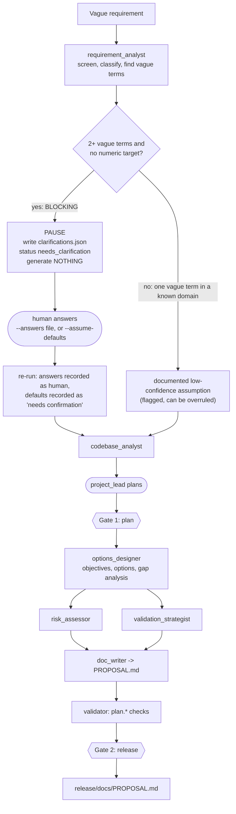

# Use case 3: Ambiguous requirement. "Make the link service faster and more secure."

**Read this first if you are new.** Shared vocabulary is in [../ARCHITECTURE.md](../ARCHITECTURE.md); run and check commands are in
[../HOW_TO_RUN_AND_VERIFY.md](../HOW_TO_RUN_AND_VERIFY.md). The other use cases: [01_GREENFIELD.md](01_GREENFIELD.md), [02_BROWNFIELD.md](02_BROWNFIELD.md).

The point of this use case: **the system must not guess.** "Faster" and "more secure" have no number and no scope. A system that builds something anyway has invented the requirement.
So it stops, asks, and only then produces a decision-ready proposal, not code.

| | |
|---|---|
| **Input** | one vague sentence, plus the existing service as context (it uses `output/greenfield/release`) |
| **Commands** | `python run.py ambiguous` (pauses), then `python run.py ambiguous --answers input/ambiguous/answers.json` or `--assume-defaults`. **Input:** `input/ambiguous/requirement.txt` and `answers.json` |
| **Output** | pass 1: `output/ambiguous/clarifications.json` and nothing else. Pass 2: `ENGINEERING_SUMMARY.md` and `release/docs/PROPOSAL.md` |
| **Time** | about 2 minutes per pass |

## 1. What takes part

| Worker | Kind | Job here |
|---|---|---|
| `requirement_analyst` | agent (rule-based core; a model may only **add** up to three questions) | detect vague terms, decide whether to block, write the questions with defaults |
| `codebase_analyst` | step | index the existing service so the proposal can say what already exists |
| `project_lead` | agent (model) | plan the analysis tasks |
| `options_designer` | step | measurable objectives, design options with trade-offs, gap analysis against the code |
| `risk_assessor`, `validation_strategist` | steps | risks and a verification plan |
| `doc_writer` | step | `docs/PROPOSAL.md` |
| `validator` | step | `plan.*` checks (not code checks: there is no code) |

There is **no `code_author` and no `spec_tester`** in this use case. No code is generated.

## 2. Design flow, step by step

**Pass 1: no answers.**
1. The analyst screens the text, then looks for vague terms from a lexicon (`faster`, `secure`, `scalable`, ...). A vague term only counts if the text has **no numeric target** (`50 ms`, `1k rps`, `99.9%`).
2. Blocking rule: two or more vague terms without numbers, or no recognised domain and under eight words. Here, `faster` and `secure` both count, so the run is **blocking**.
3. It writes `clarifications.json`, emits `run_paused` and returns `needs_clarification`. Nothing is planned and no workspace artifact exists. This is a pause, not a failure (exit code 0).
   - Q1 "Which path must be faster (redirect, create, or both) and what p95 latency target applies?"
   - Q2 "Which threats are in scope: link abuse/phishing, unauthenticated API use, code enumeration, rate-limit evasion?"
   Each has a documented default.

**Pass 2: a human answers.**
4. Answers (`input/ambiguous/answers.json`) are recorded as `resolved_by: human`. With `--assume-defaults` the defaults are recorded instead, flagged **low confidence, needs confirmation**, and shown in the proposal.
5. The `codebase_analyst` indexes the existing service. The lead plans six tasks. A real plan (`output/ambiguous/plan.json`): `design_options`, then `assess_risks` and `define_verification` in parallel, then `write_proposal`, then `validate_proposal`, then `summarize_evidence`.
6. **Gate 1: a human approves the plan.**
7. `options_designer` turns each answer into a **measurable objective** (a metric and a target), lists **options with gain, cost and risk**, and does a **gap analysis**: for each option it checks whether the codebase already has it.
8. Risks and a verification plan are produced, the proposal is written, the validator runs, **Gate 2** approves the release.

**What the proposal concluded in the committed run** (from `release/docs/PROPOSAL.md`):

| Objective | Target (source: human answer) | Gap-aware recommendation |
|---|---|---|
| Reduce redirect latency | p95 under 30 ms at 1,000 requests/second, redirect path only | A read-through cache **already exists** (`shortener/cache.py:LinkCache`): do not rebuild it. Capture a baseline with the load script, then add Redis, then a CDN, only if the target is still missed |
| Reduce abuse and unauthorised use | link abuse and unauthenticated API writes in scope; API keys on write endpoints plus per-key rate limiting; phishing screening is a later phase | API keys and quotas now; reputation screening asynchronous, in shadow mode first |

Risks listed: optimising the wrong bottleneck, security controls adding latency or false positives, scope creep, regression in the redirect path.

## 3. Test cases

Validator checks (the `plan.*` family); all 5 passed in the committed run:

| Check | Meaning |
|---|---|
| `plan.ambiguities_resolved` | every blocking ambiguity has a human answer or a recorded default |
| `plan.objectives_measurable` | every objective has a metric and a real target (not "unspecified" or "to be defined") |
| `plan.options_with_tradeoffs` | every objective has evaluated options |
| `plan.verification_defined` | the validation plan has at least one layer |
| `docs.proposal_present` | `docs/PROPOSAL.md` exists (a warning if missing) |

Framework tests (offline, scripted model; `tests/test_e2e.py` `AmbiguousTests`, `tests/test_agents.py`):
- **pauses with questions, then resumes with answers**: the first pass writes `clarifications.json` and plans nothing; the second pass completes, with the answers recorded as human;
- **`--assume-defaults` records unconfirmed assumptions**, flagged "needs confirmation";
- **no code is generated** for an undefined goal;
- a numeric target removes the ambiguity; partial answers still pause; a model may only add questions and its reply is capped and sanitised;
- requirement text that tries to give instructions ("ignore previous instructions ...") is flagged and treated as data.

**Check it yourself:** `python run.py ambiguous` should end `needs_clarification` and leave only `clarifications.json`. After answering, `python scripts/verify_outputs.py ambiguous` and open `output/ambiguous/release/docs/PROPOSAL.md`.

## 4. Decisions and why

| Decision | Why | Trade-off |
|---|---|---|
| **Pause and generate nothing** when the requirement is blocking | building against a guessed target is the failure this use case exists to expose | a slower first interaction |
| A lexicon decides ambiguity, not a model | reproducible, pinned by tests, fails predictably | it misses ambiguity with no known vague word, and can over-trigger |
| A numeric target removes ambiguity | `p95 under 50 ms` is a requirement, `faster` is not | a wrong number is accepted as a target |
| Two or more vague terms block; one vague term in a known domain becomes an assumption | asking about everything makes the system useless; asking about nothing builds the wrong thing | the threshold is a judgement call |
| Assumptions are flagged and shown at the plan gate and in the proposal | a human can still overrule them | a reader must look |
| A model may only **add** clarification questions | a model cannot remove a question or change a default | it cannot improve the questions either |
| Answers recorded as `human`, defaults as `default` | the audit trail shows who decided | none |
| Output is a **proposal**, not code | the goal is not confirmed; a decision-ready document with measurable objectives is the useful result | no implementation is produced |
| Gap analysis against the real code | stops the proposal from recommending something that already exists | limited to what the AST model recognises |
| Objectives must carry a metric and a target (checked by the validator) | "faster" must become something testable | targets come from the human's answers |
| Validation here checks the **plan**, not code | there is no code to execute | the validator proves the proposal is well-formed, not that its recommendations are right |

## 5. Limits

Ambiguity detection is lexical. There is no implementation recipe for "faster and more secure", so the system proposes and does not build. The gap analysis recognises only what the codebase analyst can see (decorator routes, SQL literals, class names).
The proposal's recommendations are judgement calls for a human to accept at the gate.
