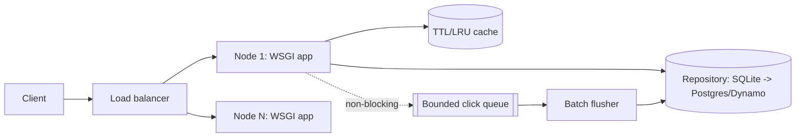

# Architecture

**Style:** stateless HTTP service + repository port + async analytics pipeline.

## Components

| Component | Responsibility |
|---|---|
| HTTP/WSGI layer (app.py) | routing, request parsing, error mapping, auth, rate limit, request-id |
| ShortenerService (service.py) | business rules: validate, allocate code (retry), cache, resolve, stats |
| Validation (validation.py) | URL/alias policy: scheme allow-list, private-host block, length |
| Repository (storage.py) | persistence port; SQLite adapter; versioned migrations; batch click insert |
| TTLCache (cache.py) | bounded LRU+TTL read-through cache for redirects |
| ClickRecorder (analytics.py) | bounded queue, background batch flush, device classification, visitor hashing |
| TokenBucketLimiter (ratelimit.py) | per-client create throttling |

## Data flows

- create: client -> app (auth, rate limit) -> service.validate -> repo.create_link (UNIQUE) -> 201
- redirect: client -> app -> service.resolve -> cache hit? else repo.get_link -> recorder.record (non-blocking) -> 302
- analytics: recorder queue -> batch flush -> click_events (+ click_daily upsert) -> GET /stats aggregates

## Capacity model (assumptions, not measurements)

| Quantity | Value |
|---|---|
| New links / month | 10,000,000 |
| Read:write ratio | 100:1 |
| Redirects/s average / peak | 385.8 / 3858.0 |
| Creates/s average / peak | 3.9 / 38.6 |
| Links after 5 years | 600,000,000 |
| Link storage | 300.0 GB |
| Click-event storage | 100.0 GB / month (needs rollup + retention) |
| Code space (7 base62) | 3,521,614,606,208 |
| Collision probability per insert at 1B links | 0.000284 |

## Scale-out path

1. run N identical stateless nodes behind an L4/L7 load balancer
1. swap SQLite adapter for PostgreSQL (hash-shard on code) or DynamoDB
1. replace in-process cache with Redis; add CDN for 301/hot links
1. replace recorder with Kafka producer + ClickHouse consumer
